> [!NOTE]
> This document specifies **technical system architecture only** (data flow, storage, APIs, concurrency, state synchronization, and security).
> All visual, aesthetic, and UI design decisions (colors, typography, component styling, responsive layout) must be defined in `design.md`.

## Context

The portfolio is a client-side React 19.3 single-page application built on Vite, deployed to Vercel's global Edge CDN, and running an in-browser physics engine (d3-force) alongside SVG/HTML overlays. Evaluator audits identified that initial node seeding caused edge crossings in the $K_4$ subgraph, bridge geometry was asymmetrically lopsided, light theme contrast needed hardening, and candidate bio copy needed canonical alignment with verified Brown University background.

## System Architecture Diagram

```mermaid
flowchart TD
    subgraph DataLayer ["Data Layer (Single Sources of Truth)"]
        ProfileData["src/data/profile.ts\n(CandidateProfile: Brown University bio, email, social links)"]
        GraphSeeds["src/data/graphSeeds.ts\n(PLANAR_NODE_SEEDS: Authoritative normalized K4 planar map)"]
        ProjectCatalog["src/data/projects.ts\n(ProjectData[]: mandatory shortTitle, repo, liveUrl)"]
    end

    subgraph Client ["Client Browser Runtime (React 19.3)"]
        ThemeInit["public/theme-init.js\n(Synchronous blocking script: reads localStorage)"]

        subgraph State ["Application State (App.tsx)"]
            ActiveProject["activeProjectId: string | null"]
            HoveredProject["hoveredProjectId: string | null"]
            ViewModeState["view: 'graph' | 'list'"]
            ThemeState["theme: 'light' | 'dark' (Default: 'light')"]
        end

        subgraph GeometryLayer ["Mathematical Geometry & Physics"]
            BridgeMath["src/utils/bridgeGeometry.ts\n(computeBridgeGeometry: C1 tangent continuity, normal-mirrored)"]
            SimEngine["src/physics/graphSimulation.ts\n(d3-force: weak seed homing strength 0.02)"]
        end

        subgraph HUD ["Presentation Components"]
            Controls["ControlsOverlay\n(Header: About, GitHub, Graph, Theme, Filters)"]
            About["AboutModal\n(Brown University Bio, Top Contact Actions)"]
            Drawer["ProjectDrawer\n(Sticky Header: Code + Visit ↗; Tablist: Media, Terminal)"]
            HoverCard["NodeHoverCard\n(Interactive with 150ms Transfer Zone)"]
            Grid["ListView\n(16:9 Thumbnails + Terminal Specimen Fallback)"]
        end
    end

    subgraph Edge ["Vercel Edge CDN Infrastructure"]
        VercelJson["vercel.json\n(CSP: frame-src 'self' https://drive.google.com)"]
        CspGuard["src/utils/csp.ts\n(SPEC_CSP synchronized)"]
    end

    ThemeInit -.-> ThemeState
    ProfileData --> About
    ProfileData --> Controls
    GraphSeeds --> SimEngine
    ProjectCatalog --> SimEngine
    ProjectCatalog --> Grid
    BridgeMath --> SimEngine
    VercelJson -.-> Client
    CspGuard -.-> VercelJson
```



## Goals / Non-Goals

**Goals:**
- Provide a provably planar initial and reduced-motion layout for all 6 projects by nesting `sandwave-sim` inside the $K_4$ triangle, backed by weak d3-force seed-homing (`strength: 0.02`) toward a crossing-free resting equilibrium.
- Enforce 100% bilateral reflection symmetry and true $C^1$ tangent continuity across all fluid bridges using `computeBridgeGeometry`, complete with close-node distance guards ($d \le R_A + R_B$).
- Default new visitors to Light theme while preventing dark-user first-paint flash via `public/theme-init.js`.
- Standardize typography across the codebase on Helvetica / Helvetica Neue, Helvetica Light (`font-weight: 300`), and scope Menlo monospace strictly to `TerminalSimulator` and the canvas coordinate ticker.
- Surface canonical candidate credentials (Brown University bio, email, social links) cleanly at the top of the About modal.
- Retire the redundant `Link` tab from `ProjectDrawer` in favor of elevated `Code ↗` and `Visit ↗` buttons in the sticky header.

**Non-Goals:**
- Guaranteeing zero edge crossings *during active manual drags* (user dragging temporarily displaces nodes).
- Replacing d3-force with alternative physics engines.
- Client-side PDF rendering via heavy WebAssembly bundles (click-to-load iframe handles previews).
- Backend server-side rendering or database APIs (100% static edge SPA).

## Technical Decisions

### 1. Authoritative Planar Seed Geometry & Weak Homing
- **Topology Analysis**: The 6 portfolio projects form an undirected graph with 9 links derived from shared technology tags in `src/data/projects.ts`:
  1. `open-dungeon` &mdash; `agentic-resume-builder` (Agent Tooling)
  2. `open-dungeon` &mdash; `pict-climate-risk-viz-chatbot` (Express, LLM)
  3. `open-dungeon` &mdash; `transcribe-plus` (Express, Vanilla JS)
  4. `open-dungeon` &mdash; `sandwave-sim` (Vanilla JS)
  5. `open-dungeon` &mdash; `attention-max` (Vanilla JS)
  6. `pict-climate-risk-viz-chatbot` &mdash; `transcribe-plus` (Express)
  7. `transcribe-plus` &mdash; `sandwave-sim` (Audio, Vanilla JS)
  8. `transcribe-plus` &mdash; `attention-max` (Vanilla JS)
  9. `sandwave-sim` &mdash; `attention-max` (Vanilla JS)
- **$K_4$ Planar Embedding**: Four nodes (`open-dungeon`, `transcribe-plus`, `sandwave-sim`, `attention-max`) form a complete $K_4$ subgraph. In any straight-line planar drawing of $K_4$, the 4 vertices cannot be in convex position (otherwise their two diagonals cross). Therefore, exactly one vertex must be embedded strictly in the interior of the triangle formed by the other three. We choose the straight-line planar embedding that places `sandwave-sim` strictly in the interior of $\triangle(\text{open-dungeon}, \text{transcribe-plus}, \text{attention-max})$, with `agentic-resume-builder` placed to the far left and `pict-climate-risk-viz-chatbot` placed at the top.
- **Authoritative Coordinates (`src/data/graphSeeds.ts`)**:
  ```ts
  export const PLANAR_NODE_SEEDS: Record<string, { x: number; y: number }> = {
    'agentic-resume-builder':        { x: 0.18, y: 0.50 },
    'open-dungeon':                  { x: 0.40, y: 0.48 },
    'pict-climate-risk-viz-chatbot': { x: 0.56, y: 0.22 },
    'transcribe-plus':               { x: 0.72, y: 0.42 },
    'sandwave-sim':                  { x: 0.56, y: 0.55 }, // Nested strictly inside OD-TP-AM
    'attention-max':                 { x: 0.52, y: 0.80 },
  };
  ```
- **Definition of "Planar" & Guarantees**:
  1. **Initial Mount Layout**: When normalized seeds are scaled to canvas dimensions ($x = \text{seed}.x \times W, y = \text{seed}.y \times H$), the graph has strictly 0 segment intersections across all 9 links across all positive aspect ratios ($W > 0, H > 0$).
  2. **Reduced-Motion Layout (`staticRing`)**: Renders directly from scaled planar seeds with 0 edge crossings.
  3. **Resting Simulation State**: The unperturbed d3-force simulation initializes at these planar seeds and applies weak seed-homing forces (`seedX`/`seedY` with `strength: 0.02`), settling at an equilibrium with 0 edge crossings.
  4. **Interactive Drag Boundary**: Active user dragging is permitted to temporarily displace nodes. Once released, the seed-homing forces guide the graph back into the planar resting basin of attraction.

### 2. Bilateral Tangent-Continuous Bridge Geometry
- **Formulation in `src/utils/bridgeGeometry.ts`**:
  1. Direction vector $\vec{D} = B - A$, distance $d = \|\vec{D}\|$, unit direction $\vec{u} = \vec{D} / d$, normal $\vec{n} = (-u_y, u_x)$.
  2. **Close-node guard**: when $d \le R_A + R_B$, `computeBridgeGeometry` returns `null` to bypass bridge drawing and prevent inverted curves when circles touch or overlap during drag or close proximity.
  3. **Anchor spread**: half-width $h = \min(R_A, R_B) \times 0.65$, spread angle $\theta_A = \arcsin(h / R_A)$ and $\theta_B = \arcsin(h / R_B)$. Capped at $\theta \le \pi / 6.5$ ($28^\circ$) to prevent adjacent bridges from merging at the 5-degree `open-dungeon` hub.
  4. **Perimeter anchors**:
     $$A_{top} = A + R_A(\cos\theta_A \vec{u} + \sin\theta_A \vec{n}), \quad A_{bottom} = A + R_A(\cos\theta_A \vec{u} - \sin\theta_A \vec{n})$$
     $$B_{top} = B - R_B(\cos\theta_B \vec{u} - \sin\theta_B \vec{n}), \quad B_{bottom} = B - R_B(\cos\theta_B \vec{u} + \sin\theta_B \vec{n})$$
  5. **$C^1$ Tangent Vectors & Endpoint Derivatives**:
     Circle unit tangent at $A_{top}$ pointing forward toward B: $\vec{T}_{A,top} = \sin\theta_A \vec{u} - \cos\theta_A \vec{n}$.
     Circle unit tangent at $B_{top}$ pointing forward toward B: $\vec{T}_{B,top} = \sin\theta_B \vec{u} + \cos\theta_B \vec{n}$.
     Tangent vector at $B_{top}$ pointing backward into the bridge toward A: $-\vec{T}_{B,top} = -\sin\theta_B \vec{u} - \cos\theta_B \vec{n}$.
  6. **Control Points**:
     Calculated directly as positive scalar multiples of the tangent vectors:
     $$CP1_{top} = A_{top} + L \vec{T}_{A,top}, \quad CP2_{top} = B_{top} - L \vec{T}_{B,top}$$
     where handle length $L = \min((d - R_A - R_B) \times 0.45, \min(R_A, R_B) \times 1.2)$.
     This guarantees true $C^1$ continuity: $(CP1_{top} - A_{top}) \cdot (A_{top} - A) = 0$ and $(B_{top} - CP2_{top}) \cdot (B_{top} - B) = 0$.
  7. **Bilateral Reflection**:
     The lower curve is an exact normal reflection of the upper curve across $\vec{u}$:
     $$(CP1_{bottom} - A) \cdot \vec{n} = -((CP1_{top} - A) \cdot \vec{n}), \quad (CP2_{bottom} - A) \cdot \vec{n} = -((CP2_{top} - A) \cdot \vec{n})$$
     with identical axial projections, guaranteeing $y_{bottom}(x) = -y_{top}(x)$ in edge-local coordinates.

### 3. Font Standardization & Monospace Boundary
- **UI Typography**:
  - Primary font stack: `'Helvetica Neue', Helvetica, -apple-system, BlinkMacSystemFont, Arial, sans-serif` for brand, headings, body, and **canvas project node label pills**.
  - Secondary font stack: `'Helvetica Neue Light', 'Helvetica Neue', 'Helvetica Light', -apple-system, BlinkMacSystemFont, Arial, sans-serif; font-weight: 300` for metadata, tags, and timestamps (falls back cleanly to Arial with `font-weight: 300` on Windows/Linux).
  - Web font removal: `@fontsource-variable/space-grotesk` and `@fontsource-variable/jetbrains-mono` imports are removed from `src/main.tsx`. `GraphCanvas.tsx` standardizes label pills to `'500 12px "Helvetica Neue", Helvetica, -apple-system, BlinkMacSystemFont, Arial, sans-serif'` and eliminates `document.fonts.load(...)` mono blocking.
- **Monospace Boundary**:
  - Monospace stack: `Menlo, Monaco, Consolas, "Liberation Mono", "Courier New", monospace` (falls back to Consolas on Windows and Liberation Mono on Linux; exact glyph metrics are not expected to be pixel-identical across platforms).
  - Scoped strictly to:
    1) `TerminalSimulator.tsx` (preserving strict character grid alignment in CLI output tables)
    2) Real-time rAF coordinate ticker (`X: --- Y: ---`)

### 4. First-Paint Flash Prevention & Default Light Theme
- **Implementation**: Synchronous script `public/theme-init.js` included in `<head>` before stylesheets. It inspects `localStorage.getItem('portfolio_theme')` and immediately assigns `data-theme` on `<html>`. If unset, `<html>` defaults to Light theme.
- **CSP Compliance**: Served from `'self'` via `<script src="/theme-init.js"></script>`, fully compliant with `script-src 'self'`.

### 5. Drawer Link Tab Retirement & Elevated Actions
- **Drawer Tabs**: The legacy `Link` tab (`preview-tab-link`) is retired and completely removed from the tablist (`role="tablist"`).
- **Primary Actions**: `Code ↗` (repository URL) and `Visit ↗` (live demo/deployment URL) are permanently elevated into the sticky header directly beneath the project title.
- **Reference Links**: Any secondary or non-repository linkouts (external documentation or writeups) are placed contextually in the Project Overview / Details section.
- **Preview Modalities**: The remaining content tabs (`Media`, `Terminal`) sit in a distinct rounded segmented container (`bg-[var(--color-surface-container)] rounded-full p-1`) with $\ge 44\text{px}$ touch targets.

## Risks / Trade-offs

- **[Risk] High-Degree Hub Merging**: `open-dungeon` connects to 5 neighbors. Large bridge anchors could overlap on its perimeter.
  &rarr; *Mitigation*: Cap spread angle $\theta \le 28^\circ$ ($\pi / 6.5$) to guarantee clearance between adjacent bridges.
- **[Risk] Dynamic Drag Displacement**: Manual dragging moves a node across other links.
  &rarr; *Mitigation*: Weak seed homing (`strength: 0.02`) brings the graph back to its planar resting equilibrium once released.

## Migration & Rollback Plan

- **Zero DB Migrations**: 100% static client code and styling.
- **Rollback Strategy**: Git revert cleanly restores previous assets without residual state.
