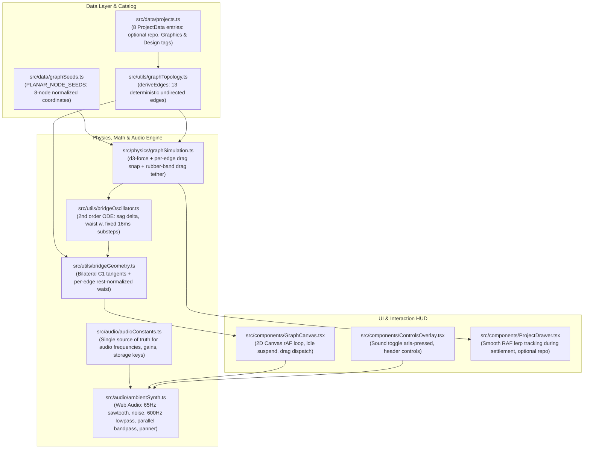

> [!NOTE]
> This document specifies **technical system architecture only** (data flow, storage, APIs, concurrency, state synchronization, and security).
> All visual, aesthetic, and UI design decisions (colors, typography, component styling, responsive layout) must be defined in `design.md`.

## Context

The portfolio is a client-side React 19 single-page application built on Vite, deployed statically to Vercel Edge. The current graph simulation renders 6 project nodes connected by static Bézier bridges. This change introduces real-time ferrofluid dynamic oscillators, per-edge drag-time bridge snapping with elastic topology restoration, a Web Audio API procedural synthesizer, and an 8-project catalog embedding that maintains strictly 0 segment crossings across desktop and mobile aspect ratios.

## System Architecture Diagram

## Goals / Non-Goals

**Goals:**
- Provide a physical ferrofluid feel where connection bridges have inertia, momentum, and viscous damping ($\zeta = 0.35, \omega_n = 14\text{ rad/s}$) integrated via fixed substeps ($\delta t_{sub} \le 16\text{ms}$).
- Formulate rest length per edge ($L_{rest}(e) = \text{distance}(\text{seed}_u, \text{seed}_v)$) so equilibrium bridges maintain full semantic thickness on both desktop and mobile viewports.
- Restrict bridge snapping strictly to active user drags ($d > 2.0 \times L_{rest}(e)$), restoring connections cleanly when $d \le 1.4 \times L_{rest}(e)$. At rest, all 13 connections remain 100% intact.
- Provide a procedural analog circuit synthesizer using native Web Audio API combining a 65Hz sawtooth with a 600Hz 24dB/oct lowpass filter (warm transformer buzz audible on mobile and laptop speakers) and a parallel 450Hz–1400Hz resonant bandpass filter ($Q=2.5$, +6dB hover swell).
- Expand catalog to 8 projects while guaranteeing every node has degree $\ge 1$ and all 13 edges produce strictly 0 crossings across desktop and mobile aspect ratios.
- Smoothly interpolate project drawer tracking during position settlement and window resize via an RAF lerp loop, snapping to integer pixels at rest.
- Suspend the continuous canvas rAF render loop when the simulation, camera transforms, and all oscillators are idle.

**Non-Goals:**
- In-browser project CRUD admin config page. The portfolio is an edge-deployed, static React/Vite single-page application where catalog projects are git-versioned TypeScript data. External URL verification is fulfilled via the standalone Node audit script (`scripts/audit-links.mjs`).
- Allowing recruiters to permanently break or delete links from the portfolio graph.
- Client-side external URL fetching in the browser (blocked by edge CSP `connect-src 'self'` and CORS).
- Heavy third-party physics engines (Matter.js, Rapier) or third-party audio libraries (Howler, Tone.js).
- Running audio playback automatically without explicit user interaction (blocked by browser autoplay policy).

## Technical Decisions

### 1. Second-Order Damped Harmonic Oscillator (`src/utils/bridgeOscillator.ts`)
- **Mathematical Model**:
  $$\ddot{\delta} + 2\zeta\omega_n \dot{\delta} + \omega_n^2 \delta = F_{perp}$$
  where $\delta$ is lateral bridge sag offset, $\omega_n = 14\text{ rad/s}$, and $\zeta = 0.35$ (underdamped).
- **Substep Integration**: Uses semi-implicit Euler integration with a fixed accumulator substep $\delta t_{sub} \le 16\text{ms}$ and maximum frame time clamped to $32\text{ms}$ to prevent physics explosion or lag under frame drops.
- **Forcing Clamping**: $F_{perp}$ is derived from the perpendicular component of endpoint relative acceleration, filtered and clamped to prevent unphysical jumps.
- **Envelope Assertion**: Tests assert monotonic decay satisfying $A(t) \le 1.10 \times \frac{A_0}{\sqrt{1 - \zeta^2}} e^{-\zeta \omega_n t}$.
- **Accessibility**: Entirely bypassed when `prefers-reduced-motion: reduce` is active.

### 2. Per-Edge Drag-Time Snapping with Elastic Topology Recovery
- **Per-Edge Rest Distance**: Each edge $e = (u, v)$ calculates:
  $$L_{rest}(e) = \|\text{seed}_u - \text{seed}_v\|$$
  scaled to container dimensions. This ensures long diagonal links (e.g. `open-dungeon` to `transcribe-plus`) and short links (e.g. on mobile) maintain proper rest widths at equilibrium.
- **Rest-Normalized Waist Cinching**:
  $$W_{waist}(d) = W_{base}(n) \times \left(1 - \frac{d - L_{rest}(e)}{d_{snap}(e) - L_{rest}(e)}\right)^{1.25} \quad \text{for } d > L_{rest}(e)$$
  where $W_{base}(n) = \min(R_A, R_B) \times 0.65$ clamped to $6 + 4(n - 1)\text{px}$. For $d \le L_{rest}(e)$, $W_{waist} = W_{base}(n)$.
- **Drag-Time Snap ($d > 2.0 \times L_{rest}(e)$)**: Active only during user drag (`isDragging === true`). When detached, the visual bridge unmounts with a fluid droplet recoil curve.
- **Rubber-Band Drag Resistance**: Pinned drag coordinates `fx`/`fy` apply a rubber-band resistance:
  $$\vec{P}_{pinned} = \vec{P}_{anchor} + \frac{\vec{\Delta}}{\sqrt{1 + (\|\vec{\Delta}\| / R_{tether})^2}}$$
  preventing any node from being dragged infinitely off-canvas.
- **Release Reconnection**: Upon pointer release (`pointerup`), the node springs back toward its resting basin. Once $d \le 1.4 \times L_{rest}(e)$, the connection bridge smoothly reforms with an underdamped harmonic ripple. Topological links remain 100% intact at rest.

### 3. Procedural Web Audio Circuit Synthesizer (`src/audio/ambientSynth.ts`)
- **Central Constants**: All audio constants are centralized in `src/audio/audioConstants.ts`:
  - `BASE_FREQ`: 65 Hz (sawtooth oscillator)
  - `BASE_LOWPASS_FREQ`: 600 Hz (24dB/oct, 4-pole cascade producing rich transformer overtones)
  - `BASE_DRONE_GAIN`: 0.063 (-24 dBFS)
  - `NOISE_FLOOR_GAIN`: 0.016 (-36 dBFS pink noise)
  - `BANDPASS_REST_FREQ`: 750 Hz ($Q = 2.5$)
  - `BANDPASS_SWEEP_MIN`: 450 Hz
  - `BANDPASS_SWEEP_MAX`: 1400 Hz
  - `HOVER_SWELL_GAIN`: 2.0 (+6 dB)
  - `PAN_MIN`: -0.75, `PAN_MAX`: 0.75
  - `RAMP_TIME_CONSTANT`: 0.05 s
  - `STORAGE_KEY`: `'portfolio_sound_enabled'`
- **Autoplay Armed Recovery**: If `portfolio_sound_enabled` is `'true'` in `localStorage` on page load, the AudioContext remains in an "armed" state, resuming seamlessly on the user's first click or touch without errors.
- **Lifecycle & Visibility**: AudioContext is a singleton. When `document.hidden === true`, the AudioContext is automatically suspended, and resumed when the tab returns to foreground if sound is enabled.

### 4. Tag-Derived 8-Node Planar Embedding (`src/data/graphSeeds.ts`)
- **Topology Formulation**:
  - `ParadigmTag` controlled union is expanded with `'Graphics'` and `'Design'`.
  - `kintsugi-fracture` is tagged with `['Graphics']` (degree 1: connects to `attention-max`).
  - `ivy-film-festival-2026` is tagged with `['Design']` (degree 2: connects to `agentic-resume-builder` and `attention-max`).
  - `sandwave-sim` has ONLY `['Vanilla JS', 'Audio']` and remains strictly nested inside $\triangle(\text{open-dungeon}, \text{transcribe-plus}, \text{attention-max})$. No external links cross this triangle.
  - Normalized coordinates place `kintsugi-fracture` at `(0.84, 0.72)` and `ivy-film-festival-2026` at `(0.15, 0.75)`.
  - Seed keys strictly equal catalog IDs (`'pict-climate-risk-viz-chatbot'` is the exact project ID).
  - Exactly 13 edges are derived; straight-line segment intersection check yields strictly 0 crossings across desktop and mobile aspect ratios.

### 5. Frame-Rate Independent Project Inspector Tracking
- Desktop drawer smoothly lerps screen coordinates during physics settlement and window resize using direct `requestAnimationFrame` lerp transforms:
  $$P_{drawer}(t + \Delta t) = P_{drawer}(t) + (P_{target} - P_{drawer}(t)) \times (1 - e^{-\lambda \Delta t})$$
  with $\lambda \approx 18$, snapping to integer pixels at rest.
