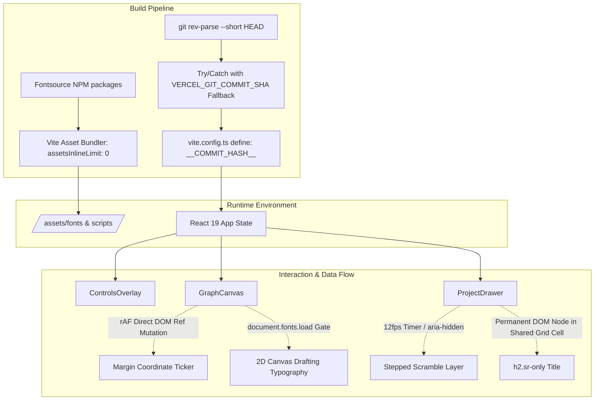

> [!NOTE]
> This document specifies **technical system architecture only** (data flow, storage, APIs, concurrency, state synchronization, and security).
> All visual, aesthetic, and UI design decisions (colors, typography, component styling, responsive layout) must be defined in `design.md`.

## Context

The portfolio application is a client-side Single Page Application (SPA) built with React 19, TypeScript, Vite, Tailwind CSS v4, and `d3-force`. The current system maintains state across URL hash routing (`#/p/:id`), canvas pointer events, and DOM tree projection for accessibility. This architecture addresses how high-frequency drafting interactions, variable font assets, and build provenance are wired into the runtime without compromising frame rates, CSP compliance, or DOM accessibility.

## System Architecture Diagram

## Goals / Non-Goals

**Goals:**
- Eliminate CSP violations by self-hosting fonts locally via npm dependencies and disabling asset inlining (`assetsInlineLimit: 0`) to prevent `data:font` generation.
- Preserve 60fps canvas animation throughput during mousemove and drag interactions by coalescing coordinate tickers to rAF via direct DOM mutation.
- Ensure 100% deterministic cold-load canvas typography rendering using `document.fonts.load('12px "JetBrains Mono Variable"')` while physics starts immediately.
- Preserve complete assistive technology compatibility (WCAG AA, single `<h1>`, clean accessible button names) and automated Playwright role selectors.

**Non-Goals:**
- Client-side theme switching engines in Phase 1 (shipping unified Dark Room technical monitor).
- Dynamic server-side rendering or remote backend endpoints (remains a pure edge-deliverable static SPA).
- Continuous per-frame trigonometric calculations across non-focal graph links.

## Technical Decisions

### 1. Font Asset Pipeline & Strict CSP Protection
- **Decision**: Install `@fontsource-variable/space-grotesk` and `@fontsource-variable/jetbrains-mono`, and configure `vite.config.ts` with `build.assetsInlineLimit: 0`.
- **Rationale**: `vercel.json` defines `default-src 'self'`. By default, Vite inlines assets $<4\text{KB}$ as base64 `data:` URIs, which would fail `default-src 'self'`. Disabling asset inlining ensures every font subset is emitted as a distinct `.woff2` file under `/assets/`.
- **Alternatives Considered**: Modifying CSP to include `data:` (rejected as it loosens edge security).

### 2. High-Frequency Coordinate Stream: Coalesced rAF Direct DOM Mutation
- **Decision**: Pass an imperative ref (`coordTickerRef`) to `GraphCanvas`. On pointer moves, record the local canvas coordinates in an internal ref and update `coordTickerRef.current.textContent` strictly within the rAF render loop.
- **Rationale**: React state updates on every pointer movement cause synchronous component re-renders while `d3-force` is calculating physics velocities. When unmounted or in list view, the ticker resets to `X: --- Y: ---`.
- **Alternatives Considered**: Raw mousemove state updates (rejected due to 60fps frame drops).

### 3. Canvas Font Synchronization: Explicit Font Load Call
- **Decision**: Initialize physics simulation and vector geometry immediately on mount. Await `document.fonts.load('12px "JetBrains Mono Variable"')` specifically before painting text labels and badges, repainting immediately upon resolution.
- **Rationale**: Canvas context `ctx.fillText` silently draws with fallback system fonts if custom webfonts are in-flight, leaving permanent unstyled text until the next physics tick.
- **Alternatives Considered**: Halting the entire simulation until fonts load (rejected as it impairs initial perceived responsiveness).

### 4. Stepped Title Scrambling: Grid-Cell Overlay over Semantic `<h2>`
- **Decision**: Place the authentic text in `<h2 className="sr-only">` and the scrambling overlay in `` inside a single-cell CSS grid (`grid-template-areas: "title"`).
- **Rationale**: Space Grotesk is a proportional font; swapping random glyphs inline causes layout width jitter. The grid cell sizes to the invisible authentic text while the overlay scrambles cleanly on top. Keeping `<h2>` prevents duplicate `<h1>` headings on the page.
- **Alternatives Considered**: In-place string mutation with delayed screen reader announcement (fragile and causes width bounce).

### 5. Build Provenance: Compile-Time Injection with Multi-Tier Fallback
- **Decision**: Inject `__COMMIT_HASH__` via Vite `define` using `execSync('git rev-parse --short HEAD')` wrapped in a try/catch block with fallback to `process.env.VERCEL_GIT_COMMIT_SHA?.slice(0, 7) || 'dev'`. Declare `declare const __COMMIT_HASH__: string` in `src/vite-env.d.ts`.
- **Rationale**: Prevents build failures in environments lacking `.git` directories (such as Vercel CLI tarball deploys).
- **Alternatives Considered**: Hardcoded git SHA strings in `src/data/projects.ts` (subject to drift on every commit).

### 6. Mobile Safe Area & Crop Marks
- **Decision**: Add `viewport-fit=cover` to `<meta name="viewport">` in `index.html`.
- **Rationale**: Without `viewport-fit=cover`, `env(safe-area-inset-*)` evaluates to 0 on mobile browsers, causing edge crop marks to collide with notch or home indicator margins.

## Risks / Trade-offs

- **[Risk]** Heavy canvas rendering on high-DPI displays causing frame drop.
  - *Mitigation*: Limit projection vectors and edge distance measurements strictly to the active/hovered node's incident edges. Non-focal links remain static 1px hairline strokes.
- **[Risk]** Rapid frame-by-frame character swapping triggering seizure sensitivity.
  - *Mitigation*: Cap scramble duration strictly at 350ms, rate limit to 12fps, and disable entirely when `prefers-reduced-motion: reduce` is detected.
- **[Risk]** Font caching on edge deployments.
  - *Mitigation*: Update `vercel.json` headers to match `/assets/(.*\\.(?:woff2|js|css))` with immutable 1-year cache headers.

## Migration & Rollback Plan

- **Rollout Strategy**:
  1. Add font dependencies, configure `vite.config.ts`, `src/vite-env.d.ts`, and `index.html`.
  2. Implement global CSS variables from `DESIGN.md`.
  3. Create `src/utils/drafting.ts` with formatters and unit tests.
  4. Update `ControlsOverlay` HUD with DOM crop marks and rAF imperative ticker.
  5. Update `GraphCanvas` with font gating and focal-only drafting geometries.
  6. Update `ProjectDrawer`, `ListView`, `TerminalSimulator`, and `MediaView` with zero-radius sweep and accessible scramble.
- **Rollback Strategy**:
  All changes are localized to standard git branches. Reverting commits cleanly restores previous component rendering with zero database or remote state migrations.
