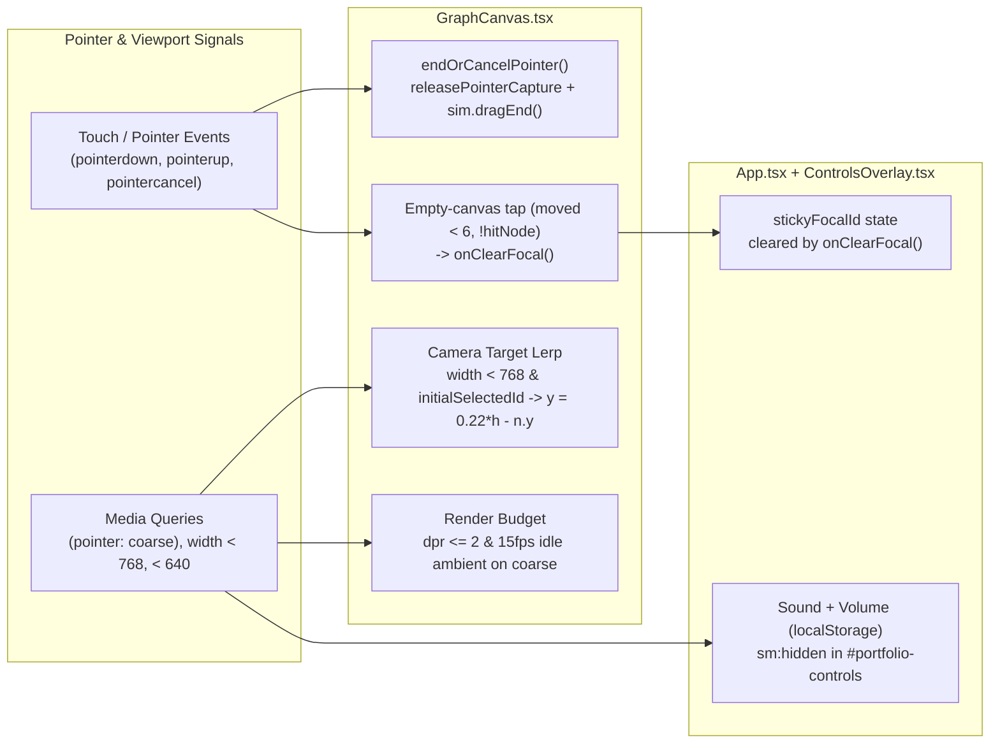

> [!NOTE]
> This document specifies **technical system architecture only** (data flow, storage, APIs, concurrency, state synchronization, and security).
> All visual, aesthetic, and UI design decisions (colors, typography, component styling, responsive layout) must be defined in `design.md`.

## Context

`portfolio-mobile-polish` refines touch pointer lifecycle, camera target coordination, responsive control placement, and mobile GPU/CPU budgeting across `GraphCanvas`, `App`, `ControlsOverlay`, and `ProjectDrawer`. No new external dependencies or backend APIs are introduced; all state remains client-side (`React` state + `localStorage` for `portfolio_sound_volume`).

## System Architecture Diagram

## Goals / Non-Goals

**Goals:**
- Guarantee drag state and synth velocity cleanup on `pointercancel` without duplicating `onPointerLeave` logic.
- Synchronize `stickyFocalId` clearing on touch via empty-canvas tap without breaking desktop hover-dwell clearing.
- Coordinate `GraphCanvas` camera pan (`< 768px`) with `ProjectDrawer`'s default `56dvh` Half-detent sheet using existing `targetRef.current` lerp, and manage 3-detent (`28dvh` / `56dvh` / `86dvh`) drag state via native Pointer Events on `sheet-drag-handle`.
- Reduce mobile pixel fill-rate (`dpr <= 2`) and idle ambient wakeup rate (`15 fps`) on coarse pointers.

**Non-Goals:**
- Rewriting `src/physics/graphSimulation.ts` boundary margins unless Phase 1 landscape checks show node overlap.
- Adding external gesture libraries (`@use-gesture`, Hammer.js) for sheet swipe-to-dismiss.

## Technical Decisions

1. **Dedicated `cancelDrag` / `pointercancel` path (`graphSimulation.ts` + `GraphCanvas.tsx`)**:
   - *Choice*: Add `sim.dragEnd({ cancel: true })` (or `sim.cancelDrag()`) in `graphSimulation.ts` that clears drag state and zeroes `vx/vy` without computing fling velocity or committing `home`. `GraphCanvas.tsx`'s `onPointerCancel` calls `sim.dragEnd({ cancel: true })`, releases pointer capture only if `e.currentTarget.hasPointerCapture(e.pointerId)`, zeroes `synthRef.current?.onDragVelocity(0, 0)`, and clears `downPosRef`, `downNodeIdRef`, and `lastDragPointRef`.
   - *Alternative*: Sharing `onPointerLeave`'s `sim.dragEnd()`. Rejected because `dragEnd()` flings with stale velocity and commits `home` on OS touch interruptions.
2. **Empty-canvas tap guard (`downNodeIdRef`)**:
   - *Choice*: Record `downNodeIdRef.current = node?.id ?? null` in `onPointerDown`; only invoke `onClearFocalRef.current?.()` in `onPointerUp` when `downNodeIdRef.current === null && moved < 6 && !hitNode(p.x, p.y)`.
   - *Alternative*: Checking `!hitNode` only on `pointerup`. Rejected because a slight finger slip off a node edge would falsely clear sticky focus.
3. **Measured-geometry camera pan with `scale` & resize recalculation (`GraphCanvas.tsx`)**:
   - *Choice*: Compute `targetY = headerBottom + (sheetTop - headerBottom) / 2` from measured header bottom and active sheet top (or detent height) with minimum-strip fallback (`< 120px` forces Peek detent), setting `goal.y = targetY - n.y * scale`. Recompute on `resize` while `initialSelectedId` is active, and reset `goal` to `(0, 0)` when `initialSelectedId` clears (even if `stickyFocalId` persists).
   - *Alternative*: Hardcoded `0.22 * height`. Rejected because it ignores header height (`h-24`), `scale`, and landscape heights (`375px`/`393px`).
4. **Timed `15 fps` idle scheduling on coarse pointers (`GraphCanvas.tsx`)**:
   - *Choice*: When `idleAmbientOnly` is true on `(pointer: coarse)`, schedule the next tick via `window.setTimeout(..., 1000 / 15)` instead of rescheduling `requestAnimationFrame` every 8–16 ms, genuinely eliminating JS wakeups between ambient frames.
   - *Alternative*: Skipping `render()` inside a continuous 60–120 Hz rAF loop. Rejected because JS callbacks still fire every display vsync.
5. **Scrollable `#portfolio-controls` dropdown (`ControlsOverlay.tsx`)**:
   - *Choice*: Constrain `#portfolio-controls` with `max-h-[calc(100dvh-5rem)] overflow-y-auto` so Sound + Filters + Reset remain reachable on short viewports (`320×568`, `852×393`).
6. **Hybrid `(hover: none)` + `< sm` / `< md` gating (`ControlsOverlay.tsx` + `ProjectDrawer.tsx`)**:
   - *Choice*: Gate in-menu Sound/volume on `< sm` OR `(hover: none)` (so iPad portrait and landscape phones avoid the 500 ms `pointerleave` race), and compute `isSheet` as `width < 768 || (isCoarse && height < 500)` so landscape phones use the bottom sheet.

## Risks / Trade-offs

- **[Risk] Existing desktop/mobile E2E tests asserting `nav-github` or top-bar `audio-toggle` on Pixel 7 fail after `< sm` move** → **Mitigation**: Update mobile assertions in `e2e/portfolio.spec.ts` to verify `mobile-audio-toggle` inside `#portfolio-controls` and `about-github` inside `AboutModal`.
- **[Risk] Panning camera on `< 768px` while `stickyFocalId` remains after sheet close** → **Mitigation**: Camera resets to `(0, 0)` as soon as `initialSelectedId` becomes `null` (when the sheet closes), while `stickyFocalId` keeps edges highlighted until empty-canvas tap or `Reset`.

## Migration & Rollback Plan

- Purely additive/responsive UI and event-handler changes; reverting the commit restores previous behavior with no persistent data migration (`portfolio_sound_volume` key is unchanged).
