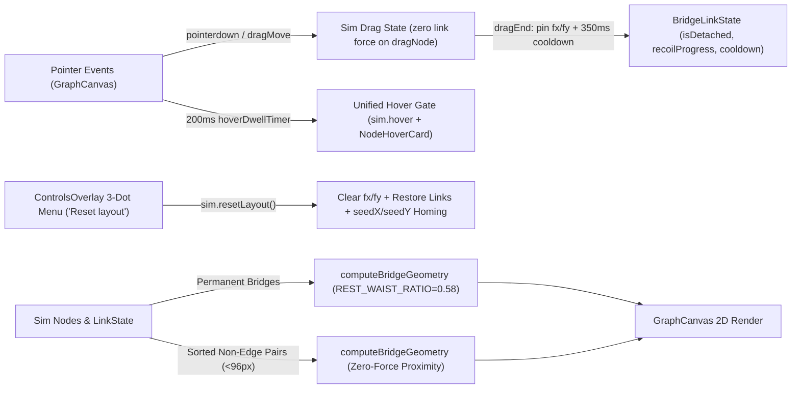

> [!NOTE]
> This document specifies **technical system architecture only** (data flow, storage, APIs, concurrency, state synchronization, and geometry/physics invariants).
> Visual, aesthetic, and UI styling decisions are defined in `design.md`.

## Context

`portfolio` renders an interactive 8-node ferrofluid force graph on a 2D `<canvas>` driven by `d3-force` (`src/physics/graphSimulation.ts`) and pure cubic-Bezier bridge math (`src/utils/bridgeGeometry.ts`), paired with a React HUD (`ControlsOverlay.tsx`, `NodeHoverCard.tsx`, `App.tsx`).

## System Architecture Diagram

## Goals / Non-Goals

**Goals:**
- Decouple `link` force on `dragNode` links during `state === 'drag'` so non-dragged neighbors remain within `< 15px` displacement.
- Persist user-placed node positions (`fx/fy`) after `dragEnd` and expose `sim.resetLayout()` wired to `"Reset layout"` in `ControlsOverlay.tsx`.
- Enforce deterministic `1.6x` snap / `1.25x` reconnect hysteresis with `220ms` visual recoil and `350ms` post-release cooldown, plus non-edge-only zero-force proximity bridges.
- Gate both `sim.hover` and `NodeHoverCard` behind a single `200ms` dwell timer with synchronous cancellation, and position `NodeHoverCard` using `ResizeObserver` measured bounds.

**Non-Goals:**
- Elliptical node squash/stretch deformation (deferred to Stage 4).
- Persisting custom node coordinates to `localStorage` across page reloads.

## Technical Decisions

1. **Persistent Pinning via `fx/fy` + Proportional Clamped Resize + `resetLayout()`**:
   - *Decision*: Store user-placed coordinates on `node.fx`/`node.fy` at `dragEnd` (replacing immediate unpinning) and add `resetLayout()` on `GraphSimulation` to clear `fx`/`fy`, clear `isDetached`, and re-heat `alpha(0.4).restart()`. Track `(prevWidth, prevHeight)` in `createSimulation`: on `resize(nw, nh)`, scale any pinned `fx`/`fy` proportionally and clamp to `[BOUNDARY_MARGIN, dim - BOUNDARY_MARGIN]` (`node.fx = clamp(node.fx * (nw / prevWidth), BOUNDARY_MARGIN, nw - BOUNDARY_MARGIN)`, and likewise for `fy`, syncing `node.x`/`node.y`).
   - *Rationale*: Reuses `d3-force`'s native pinning mechanism without inventing a parallel coordinate store while guaranteeing pinned nodes stay proportional and on-canvas across viewport resizes.
2. **Explicit `forceLink.strength` Refresh on `dragStart` / `dragEnd`**:
   - *Decision*: Because `d3-force` caches the per-link strength array internally when `.strength(fn)` is set, `dragStart` and `dragEnd` MUST explicitly re-invoke `(sim.force('link') as ForceLink<...>).strength((link) => (state === 'drag' && (link.source === dragNode || link.target === dragNode) ? 0 : LINK_STRENGTH))` so `d3-force` recomputes its internal `strengths` array synchronously.
   - *Rationale*: Checking `state` inside the callback alone would read stale cached strengths; re-invoking `.strength(...)` keeps `seedX`/`seedY`, `charge`, `collide`, and `boundary` active on all other nodes while the dragged node stretches its bridges freely.
3. **Reset Control Wiring (`ControlsOverlay` -> `App` -> `GraphCanvas`)**:
   - *Decision*: `App.tsx` holds `const [layoutResetVersion, setLayoutResetVersion] = useState(0)`, passes `onResetLayout={() => setLayoutResetVersion((v) => v + 1)}` to `ControlsOverlay`, and passes `layoutResetVersion` to `GraphCanvas`. `GraphCanvas` watches `layoutResetVersion > 0` in a `useEffect` and calls `simRef.current?.resetLayout()` + `wakeRef.current()`.
   - *Rationale*: Avoids imperative ref forwarding across `App.tsx` while keeping `GraphSimulation` encapsulated inside `GraphCanvas`.
4. **Non-Edge-Only Proximity Pass**:
   - *Decision*: Build a `Set<string>` of permanent edge keys (`linkKey(a, b)`) once at simulation/render init and skip any pair in that set during the `(i < j)` proximity loop.
   - *Rationale*: Guarantees a snapped permanent edge never spawns a duplicate proximity bridge during cooldown.

## Risks / Trade-offs

- **Mobile Reachability at `1.6x` Snap** -> Verify via `graphSimulation.test.ts` at `width: 393, height: 852` that `rubberBandDisplacement` allows stretching past `1.6 * restDistance` on all 13 edges.
- **Short-Gap $C^1$ Tangent Feasibility** -> On short edges where `baseHandle` is capped by `gap * HANDLE_GAP_RATIO`, `computeBridgeGeometry` clamps `handle` to `baseHandle` rather than breaking $C^1$ tangency.

## Migration & Rollback Plan

- Purely client-side canvas/UI change with no backend or storage schema migrations; reversible per stage or via git revert.
