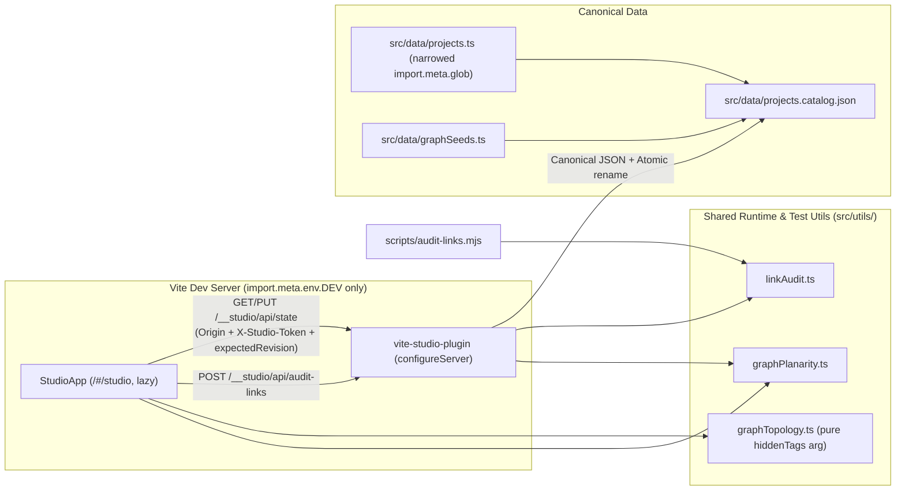

# Architecture: `project-studio`



## Goals & Non-Goals
- **Goals**:
  - Single atomic source of truth (`src/data/projects.catalog.json`) for `tags`, `hiddenTags`, `projects`, and `seeds`.
  - Zero Studio UI, routes, or APIs in production builds (`dist/` / Vercel / `vite preview`).
  - Hardened local-only CRUD (`vite-studio-plugin.ts`) with planarity enforcement (`countSeedCrossings === 0`), reserved-entity protection (`art-wip`, `'art'`), and SSRF-safe server-side link auditing.
  - Pure `deriveEdges(projects, hiddenTags?)` and `getVisibleTags(tags, hiddenTags?)` so Studio draft previews match production topology without mutating module state.
- **Non-Goals**:
  - Remote authentication, multi-user collaboration, or deploying `/#/studio` to production/preview environments.
  - Auditing site-relative URLs (e.g., `/art/`) over HTTP in `linkAudit.ts` (only absolute `http(s)` URLs are network-fetched; relative paths are validated syntactically).

## Canonical Schema & Formatting (`src/data/projects.catalog.json`)
```json
{
  "tags": ["LLM", "Express", "Vanilla JS", "Audio", "Agent Tooling", "LaTeX", "Geospatial", "WebExtension", "Graphics", "Design", "art"],
  "hiddenTags": ["art"],
  "projects": [
    {
      "id": "open-dungeon",
      "title": "...",
      "shortTitle": "OpenDungeon",
      "summary": "...",
      "classification": "...",
      "tags": ["Express", "Vanilla JS", "LLM", "Agent Tooling", "art"],
      "repo": "https://github.com/...",
      "liveUrl": "https://...",
      "omitIndex": false,
      "hideOverview": false,
      "revealLabelOnInspect": false,
      "rainbowOnInteract": false,
      "previews": [
        { "kind": "screenshot", "assetKey": "screenshots/open-dungeon.png", "caption": "..." }
      ],
      "terminalDemo": { "capturedKey": "open-dungeon", "prompt": "..." }
    }
  ],
  "seeds": {
    "open-dungeon": { "x": 0.4, "y": 0.48 }
  }
}
```
- **Deterministic Serialization**: `serializeCatalog(catalog)` emits deterministic top-level key order (`tags`, `hiddenTags`, `projects`, `seeds`), sorted `tags` / `hiddenTags` / `seeds` object keys, deterministic project field order, 2-space indentation, and a trailing newline (`\n`).
- **Revision Digest**: `revision` is the SHA-256 hex digest of those exact canonical UTF-8 bytes.

## Technical Decisions (with Alternatives)
1. **Single Atomic JSON (`projects.catalog.json`) vs. Separate `projects.json` + `seeds.json`**
   - *Choice*: Single JSON file. *Why*: Prevents double-HMR reloads and out-of-sync `projects`/`seeds` IDs during save.
2. **Tag Type Safety: `ParadigmTag = string` + Runtime Hydrator Validation vs. Build-Time `.d.ts` Codegen**
   - *Choice*: `export type ParadigmTag = string;` paired with runtime validation in `src/data/projects.ts` (every project tag must exist in `catalog.tags`, `catalog.hiddenTags` must be a subset of `catalog.tags`, and `ALL_TAGS` in `App.tsx` is derived cleanly from `catalog.tags` / hydrated projects) plus unit test assertions. *Why*: Avoids Vite plugin codegen race conditions during dev HMR while guaranteeing invalid tags fail loudly at test/load/save time.
3. **Narrowed `import.meta.glob` vs. Broad `../assets/**/*`**
   - *Choice*: `import.meta.glob('../assets/**/*.{png,jpg,jpeg,webp,mp4,webm}', { eager: true, import: 'default' })` and `import.meta.glob('./captured/*.json', { eager: true, import: 'default' })`. *Why*: Prevents bundling non-asset files as modules into `dist/`.
4. **Pure Topology Helpers (`deriveEdges`, `getVisibleTags`)**
   - *Choice*: `getVisibleTags(tags, hiddenTags = HIDDEN_TAGS)` and `deriveEdges(projects, hiddenTags = HIDDEN_TAGS)` accept an optional `ReadonlySet<string>`. *Why*: Existing callers remain backwards-compatible while `StudioApp`, `SeedMiniMap`, and `TagManager` evaluate live unsaved drafts purely.
5. **Dedicated Playwright Studio Config (`e2e/playwright.studio.config.ts`)**
   - *Choice*: Separate port (`5299`), `reuseExistingServer: false`, `PORTFOLIO_STUDIO_WRITE=1`, `PORTFOLIO_STUDIO_CATALOG_PATH=<temp>`, `desktop`-only, skipped when `PREVIEW_URL` is set. *Why*: Prevents Studio E2E tests from ever hitting or mutating a developer's running `npm run dev` server on `5199`.

## Hardening & Validation Rules (`vite-studio-plugin.ts`)
1. **Origin, Host & Fetch-Metadata Guard**: Reject requests whose `Host` or `Origin` does not match the dev server's `http://localhost:<port>` / `http://127.0.0.1:<port>`. For `GET /__studio/api/state` when `Origin` is omitted by the browser, allow only if `Sec-Fetch-Site` is `'same-origin'` or `'none'` (or absent in local Node/test calls with matching `Host`). Never emit `Access-Control-Allow-Origin` or other CORS headers.
2. **Per-Dev-Server Token & Body Cap**: `GET /__studio/api/state` exposes the in-memory CSPRNG token (`randomBytes(32)`) for the dev-server middleware lifetime; `PUT`/`POST` must supply the matching header (`403` otherwise). Reject `PUT` payloads exceeding `256KB` (`413 Payload Too Large`).
3. **Strict Input & Reserved-Entity Validation**:
   - Project `id`: must match `/^[a-z0-9-]+$/` (blocks `__proto__`, `constructor`, whitespace, path characters) and be unique.
   - Reserved entities: `'art-wip'` must remain in `projects` and `seeds`; `'art'` must remain in `tags` and `hiddenTags`.
   - `seeds`: keys must match `projects` IDs 1:1; `x` and `y` must be finite numbers in `[0, 1]`; `countSeedCrossings === 0`.
   - `tags` / `hiddenTags`: non-empty strings, no duplicates, every project tag declared in `tags`, every `hiddenTags` entry in `tags`.
   - `repo` / `liveUrl`: optional; if present, must be `https:` URL or site-relative `/` path (reject `javascript:`, `data:`, `file:`, etc.).
   - `previews` / `terminalDemo`: `assetKey` and `capturedKey` must exist in the workspace's asset/captured registries.
4. **Revision Conflict & Atomic Writes**: `PUT` requires `expectedRevision` (`409 Conflict` on mismatch), serializes concurrent writes via a promise mutex, writes canonical bytes to `.projects.catalog.json.tmp`, and `rename`s atomically.
5. **SSRF-Safe Link Audit (`POST /__studio/api/audit-links`)**: Ignores any client-supplied URLs; extracts only `http(s)` URLs from the saved `projects.catalog.json` and `src/data/profile.ts` (skipping relative paths like `/art/`). Resolves DNS manually before connecting and traverses redirects manually (`redirect: 'manual'`, max hops bounded, re-validating every redirect target), blocking loopback, private, link-local, carrier-grade NAT, and reserved IPv4/IPv6 ranges—including IPv4-mapped IPv6 (`::ffff:127.0.0.1`) and decimal/integer host notations. Pins the validated IP on default Node `http`/`https` sockets (IPv4 preferred, IPv6 fallback) while preserving the `Host` header and TLS `servername`, eliminating the DNS-rebinding window. Uses `classifyStatus` (`401`/`403`/`429`/`999` → `'warning'`).

## Risks & Migration / Rollback
- **Risks**: Accidental deletion of `art-wip` or `'art'` breaking canvas easter eggs (mitigated by validator + disabled UI controls); `portfolio-test-suite-streamlining` count pins drifting (mitigated by documenting invariant shift).
- **Production Boundary & Rollback**: `import.meta.env.DEV` is `false` in `npm run build`, tree-shaking `src/studio/*` out of `dist/`, and `studioDevPlugin` registers middleware only inside `configureServer`. Rollback is a clean revert of the catalog JSON + hydrator back to static TS arrays.
