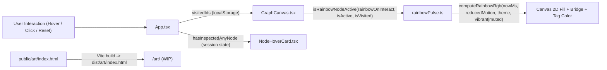

> [!NOTE]
> This document specifies **technical system architecture only** (data flow, storage, APIs, concurrency, state synchronization, and security).
> All visual, aesthetic, and UI design decisions (colors, typography, component styling, responsive layout) must be defined in `design.md`.

## Context

The portfolio runs as a client-side Vite + React 19 application deployed to Vercel with strict Content Security Policy headers (`default-src 'self'`). Graph nodes are driven by a `d3-force` simulation (`src/physics/graphSimulation.ts`) and rendered on a 2D `<canvas>` (`src/components/GraphCanvas.tsx`), while project details render in `NodeHoverCard`, `ProjectDrawer`, `MediaView`, and `ListView`.

## System Architecture Diagram

## Goals / Non-Goals

**Goals:**
- Serve `/art/` as a zero-JS, zero-inline-style static HTML endpoint (`public/art/index.html`) compatible with `vercel.json` CSP.
- Drive rainbow RGB node pulsing purely from existing state (`rainbowOnInteract` metadata, hover/selection, `visitedIds`) and `GraphCanvas`'s existing ambient render loop (30fps desktop, timed 15fps coarse-pointer idle).
- Scale normalized seed positions and homing targets through the same affine safe-canvas rectangle so the simulation's 48px boundary does not move a node off the planar embedding after initialization.
- Keep `hasInspectedAnyNode` in session-only React state so `resetAll()` preserves it while a page reload resets it.

**Non-Goals:**
- Adding a client-side router or multi-page Vite bundle for `/art/`.
- Persisting `hasInspectedAnyNode` in `localStorage`.

## Technical Decisions

1. **Static HTML in `public/art/index.html` vs. SPA route**:
   - Chosen: `public/art/index.html` copied verbatim by Vite to `dist/art/index.html`.
   - Rationale: Zero bundle overhead, satisfies `default-src 'self'` CSP, and delivers exact raw HTML `<title>WIP</title>` and `WIP` body text.
2. **Boundary-aware affine seed scaling**:
   - Chosen: Map normalized seeds into the canvas interior `[BOUNDARY_MARGIN, width - BOUNDARY_MARGIN] × [BOUNDARY_MARGIN, height - BOUNDARY_MARGIN]`, and use those same world-space positions for initial placement, seed homing, resize, and rest-distance calculation.
   - Rationale: The proposed `art-wip` x seed (`0.10`) becomes 39px at 393px width and 32px at 320px width, both inside the current 48px boundary margin. The simulation clamps those coordinates, which can change the embedding: a local segment-intersection check found a crossing at 320×900 after clamping. An affine map of the whole seed set preserves the straight-line embedding while keeping seeds inside the simulation bounds. This assumes both dimensions exceed twice the margin; smaller canvases need an explicit compact-layout policy.
   - Alternative considered: Adjust only `art-wip`'s x coordinate. That causes an intersection with the existing AttentionMax–Ivy edge at these narrow widths and is not sufficient.
3. **Pure `src/utils/rainbowPulse.ts` module**:
   - Chosen: Extract `isRainbowNodeActive` and `computeRainbowRgb` from `GraphCanvas.tsx`.
   - Rationale: Keeps HSL→RGB math, reduced-motion fallback, and activation truth table unit-testable in Node without Canvas mocks.
4. **Session-only `hasInspectedAnyNode` state in `App.tsx`**:
   - Chosen: `useState(false)` set to `true` inside `openProject`, omitted from `resetAll()`.
   - Rationale: Survives canvas resets (`Reset layout`) within the session while resetting naturally on page reload.

## Risks / Trade-offs

- **[Risk] Boundary clamping moves normalized seeds and can introduce crossings** → **Mitigation**: Apply one shared affine safe-canvas transform to initial positions, homing, resize, and rest-distance calculations; test the transformed positions and settled graph at 1440×900, 393×852, 1920×1080, and 320×900.
- **[Risk] Continuous rainbow animation under `prefers-reduced-motion: reduce`** → **Mitigation**: `computeRainbowRgb` returns a static fixed hue when `reducedMotion` is `true`, and `GraphCanvas` already halts the continuous `rAF` loop in reduced-motion mode.
- **[Risk] Some hues do not maintain readable contrast against both themes** → **Mitigation**: Keep node labels at the theme foreground, add a stable contrasting node outline, and solve the muted tag-pill text lightness against the actual light/dark pill background per hue. Test 4.5:1 for the tag text and 3:1 for the node outline across the full cycle, including the reduced-motion static hue.
- **[Risk] Lowering hover dwell from 250ms to 150ms can increase accidental card/physics activation during pointer sweeps** → **Mitigation**: Keep card and physics activation on the same timer; test a sweep shorter than 150ms and a stationary dwell that reaches 150ms, along with immediate cancellation on pointerdown/leave.

## Migration & Rollback Plan

- Additive data/UI change with no schema migrations. Rollback is a single revert commit.
