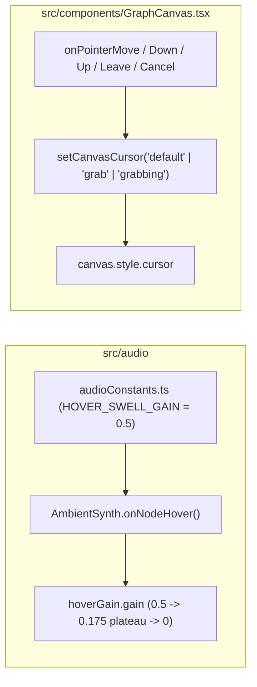

> [!NOTE]
> This document specifies **technical system architecture only** (data flow, storage, APIs, concurrency, state synchronization, and security).
> All visual, aesthetic, and UI design decisions (colors, typography, component styling, responsive layout) must be defined in `design.md`.

## Context

This change touches two existing, isolated client-side subsystems with zero backend, storage-schema, or API changes:
1. **Procedural Web Audio (`src/audio/`)**: `AmbientSynth` reads `HOVER_SWELL_GAIN` and `HOVER_SWELL_PLATEAU` from `src/audio/audioConstants.ts` when ramping `hoverGain.gain` inside `onNodeHover()`. `DEFAULT_SOUND_ENABLED` is already `false`.
2. **Graph Canvas Pointer Handling (`src/components/GraphCanvas.tsx`)**: Pointer event handlers (`onPointerMove`, `onPointerDown`, `onPointerUp`, `onPointerCancel`, `onPointerLeave`) mutate `canvasRef.current.style.cursor` directly via `setCanvasCursor()` to keep pointer hit-testing off React's render path.

## System Architecture Diagram

## Goals / Non-Goals

**Goals:**
- Scale the entire node interaction swell (initial peak and sustained 35% plateau) by 50% via the single `HOVER_SWELL_GAIN` constant.
- Keep `setCanvasCursor` synchronous and zero-re-render while differentiating hover (`grab`) from active press/drag (`grabbing`).

**Non-Goals:**
- Changing `DEFAULT_SOUND_ENABLED`, `localStorage` sound persistence, `BASE_DRONE_GAIN`, `NOISE_FLOOR_GAIN`, or `MASTER_GAIN`.
- Modifying `ProjectDrawer` border drag cursor (`move`) or Studio `SeedMiniMap` cursor styling.

## Technical Decisions

1. **Adjust `HOVER_SWELL_GAIN` (`1.0 -> 0.5`) rather than adding a multiplier in `AmbientSynth`**:
   - *Rationale*: `audioConstants.ts` is the documented single source of truth for both `AmbientSynth` and `ambientSynth.test.ts`. Halving `HOVER_SWELL_GAIN` automatically halves both the initial swell (`0.5`) and the sustained plateau (`0.5 * 0.35 = 0.175`).
   - *Alternative considered*: Scaling inside `onNodeHover()`. Rejected because it splits gain tuning across two files and breaks constant/test parity.
2. **Widen `setCanvasCursor` union to `'default' | 'grab' | 'grabbing'`**:
   - *Rationale*: Preserves direct DOM mutation (`canvas.style.cursor`) with a redundant-write guard (`if (canvas.style.cursor !== cursor)`), avoiding React state churn on high-frequency `pointermove` events.
   - *Alternative considered*: Managing cursor via React state / Tailwind classes. Rejected because it forces component re-renders on every pointer hover boundary crossing.

## Risks / Trade-offs

- **Reduced-motion press on a node** → `onPointerDown` sets `'grabbing'` and `onPointerUp` restores `'grab'` (or `'default'`). Even when `reduceMotionRef.current` skips `sim.dragStart`, the press-and-release cycle is brief and cleanly restores `'grab'` on `pointerup`.

## Migration & Rollback Plan

- Purely client-side constant and DOM cursor update. Rollback is a single-commit revert of the two source files and two test files.
