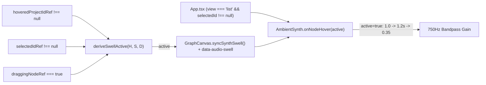

> [!NOTE]
> This document specifies **technical system architecture only** (data flow, storage, APIs, concurrency, state synchronization, and security).
> All visual, aesthetic, and UI design decisions must be defined in `design.md`.

## Context

`GraphCanvas.tsx` currently drives `synthRef.current?.onNodeHover(boolean)` directly from `emitHover` (`L1172`, `L1176`), `focusedId` effect (`L1062`), and `handleMotionChange` (`L684`), while `ListView` unmounts `GraphCanvas` completely. Meanwhile `HOVER_SWELL_GAIN = 2.0` clips at `+1.5 dBFS` and stays at full peak if sustained.

## System Architecture Diagram

## Goals / Non-Goals

**Goals:**
- Extract pure `deriveSwellActive(hovered, selected, dragging)` in `src/utils/audioSwell.ts`.
- Route all 4 `GraphCanvas.tsx` call sites (`emitHover`, `focusedId` effect, `handleMotionChange`, plus `initialSelectedId` effect, pointer handlers, and unmount cleanup) through `syncSynthSwell()` and mirror the state onto `<canvas data-audio-swell>`.
- Sync `synth.onNodeHover(selectedId !== null)` in `App.tsx` when `view === 'list'` so Grid-view inspection also triggers the swell.
- Lower `HOVER_SWELL_GAIN` to `1.0` and add a `1.2 s` decay timer in `AmbientSynth.onNodeHover` to settle to `0.35` plateau without re-triggering if already active.

**Non-Goals:**
- Modifying `BASE_DRONE_GAIN`, `BASE_LOWPASS_FREQ`, or adding iOS `audioSession` workarounds.

## Technical Decisions

1. **Idempotent `onNodeHover(true)` + `1.2 s` plateau timer in `AmbientSynth`**:
   - *Choice*: Track `private swellActive = false` and `private swellPlateauTimer`. When `onNodeHover(true)` is called while `!this.swellActive`, ramp to `HOVER_SWELL_GAIN` (`1.0`) and schedule a `1200 ms` timeout to ramp to `HOVER_SWELL_GAIN * 0.35`; repeated `onNodeHover(true)` calls while `swellActive` is already `true` are no-ops so `syncSynthSwell()` never resets the plateau. `onNodeHover(false)` clears the timer, sets `swellActive = false`, and ramps to `0`.
   - *Alternative*: Re-ramping to `1.0` on every `syncSynthSwell()` call. Rejected because transitioning from drag to inspect would re-spike the volume.
2. **Graph vs. Grid view coverage**:
   - *Choice*: `GraphCanvas.tsx` handles `deriveSwellActive(hovered, selected, dragging)` while mounted; `App.tsx` runs a `useEffect` when `view === 'list'` calling `synth.onNodeHover(selectedId !== null)`.

## Risks / Trade-offs

- **[Risk] Unmount while `initialSelectedId` is set or `swellPlateauTimer` leaks** → **Mitigation**: `GraphCanvas` cleanup calls `synthRef.current?.onNodeHover(false)` (only when `view === 'graph'`, or `App` re-syncs for `list`), and `AmbientSynth.dispose()` clears `swellPlateauTimer`.

## Migration & Rollback Plan

- Purely local audio/state changes with no persistent storage schema changes.
