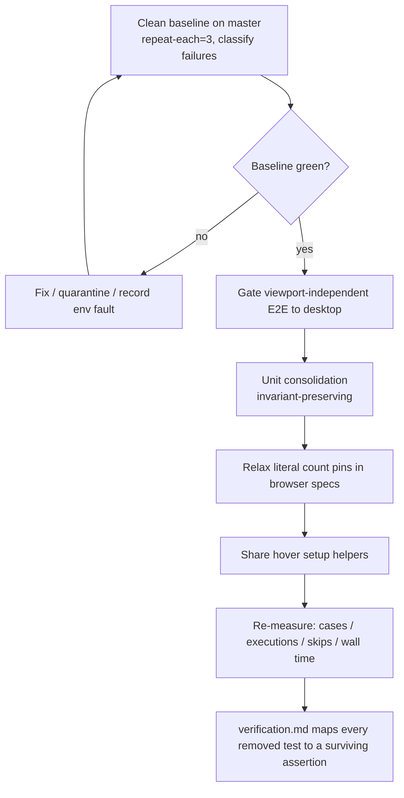
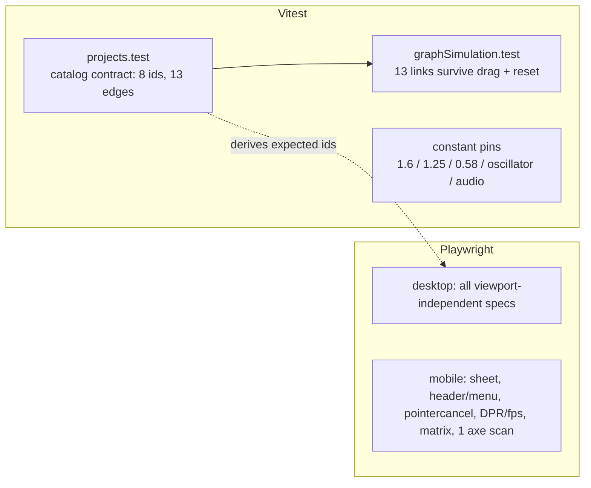

> [!NOTE]
> This document specifies **technical system architecture only** (data flow, storage, APIs, concurrency, state synchronization, and security).
> All visual, aesthetic, and UI design decisions (colors, typography, component styling, responsive layout) must be defined in `design.md`.

## Context

The repo runs two test layers: Vitest unit tests (206 tests, 19 files, well under 1 s of test time) and Playwright E2E (`playwright.config.ts`: `desktop` = Desktop Chrome, `mobile` = Pixel 7, `workers: 1`, local dev server on port 5199). CI runs `typecheck`, `build`, `test:unit` with `REQUIRE_DIST=1`, then `test:e2e`. A separate preview workflow runs `preview-headers.spec.ts` and a subset of `portfolio.spec.ts` against a live Vercel preview.

The last full run on `master` executed 108 project executions (41 of 72 spec titles run on both projects), skipped 36, and had 14 failures, 9 of which were `ERR_CONNECTION_REFUSED` dev-server drops. See `research.md` for the measured numbers and how each was verified.

This change touches **test code only**. No application source, build config, or CI workflow changes.

## System Architecture Diagram

## Goals / Non-Goals

**Goals:**
- Remove only redundancy: the same invariant asserted in several layers, or the same browser behavior executed on a project where it cannot differ.
- Preserve every guarded invariant. Every removed or merged test is mapped to a surviving assertion.
- Make browser completeness checks independent of the literal project count.
- Report cases, executions, and skips separately, and re-measure wall time after gating.

**Non-Goals:**
- A condition-based camera-settled signal replacing `waitForTimeout(1500/1600)`. That needs an app-side hook and is a separate follow-up change.
- Changing Playwright `workers`, projects, retries, or sharding.
- Making `buildOutput.test.ts` unconditional.
- Reshaping `e2e/preview-headers.spec.ts` or the preview workflow.
- Any lower test-count target.

## Technical Decisions

1. **Gate with `test.skip(isMobile(testInfo), reason)` inside each spec.**
   Alternatives: per-project `testIgnore` globs (needs splitting the 1733-line spec file, hides which specs are gated); `testMatch` tags. Chosen because the repo already uses 26 such skips, the reason string shows up in the reporter, and the diff is a few lines per spec.

2. **Gate on desktop, not mobile, for viewport-independent specs.** Desktop runs the full hover/drag/cursor set and is the project CI also exercises against the preview, so keeping desktop as the single home loses nothing and keeps one canonical run.

3. **Keep one mobile axe scan: the open project drawer.** The drawer becomes a bottom sheet on mobile, the only surface whose layout (and therefore contrast and target-size results) differs materially. Other axe surfaces are DOM-driven and match desktop. Axe is ~11% of E2E time, so merging axe/theme pairs is **not** part of this change.

4. **Derive browser completeness from the catalog.** The list and semantic-nav specs import `projects` (or the existing `PROJECT_IDS` constant, replaced by a catalog-derived list) and assert one card and one nav entry per id. Alternative of keeping `toHaveCount(8)` rejected: it breaks on a ninth project even though the contract is "everything in the catalog renders". The literal `8` stays asserted once, in `projects.test.ts`.

5. **Fold constant pins only into tests that still assert the literal.** A behavioral test that imports `SNAP_MULTIPLIER` to build its input does not guard the value. When folding, the surviving test keeps an explicit `expect(CONSTANT).toBe(1.6)` (or equivalent). Alternative of deleting the pins rejected: constant drift would go green.

6. **Two layers of edge assertions.** Catalog layer asserts the derived edge set (13) once; simulation layer asserts links survive drag + reset. Geometry and planarity tests drop their count pins but keep their geometric assertions.

7. **Helpers over merging.** Extend `hoverCenteredNode` / `focusNode` / `tapCenteredNode` for setup reuse. Merging scenarios (theme phases, About variants) rejected: a failure then fails the whole story and reports a vague title.

8. **Baseline gate.** The refactor is only judged against a clean baseline: failures are re-run with `--repeat-each=3`, and `ERR_CONNECTION_REFUSED` is treated as an environment fault. If a real regression is found on `master`, it is fixed or quarantined in a separate commit, not hidden by the refactor.

## Risks / Trade-offs

- **A gated spec stops catching a mobile-only regression** → gate only specs with layout- and input-independent assertions; keep the drawer axe scan and all sheet/header/menu/pointercancel/DPR/matrix specs on mobile; verify in `verification.md` that every spec still executes on at least one project.
- **Folding a constant pin silently drops its literal assertion** → require an explicit literal assertion in every surviving test; reviewer checks the mapping table in `verification.md`.
- **Flaky specs distort the before/after timings** → timings are taken from the clean baseline run, not the 14-failure run; report variance if a rerun differs.
- **Count pins removed from E2E but the catalog test drifts** → the catalog contract test stays the single place the literal `8` and `13` are asserted.
- **Gating saves less than expected** (~10 s from the 11 viewport-independent mobile runs) → accepted; the large win is the camera-settled signal in the follow-up change, and this change is justified by reduced noise and a clean baseline.

## Migration & Rollback Plan

Test-only change, shipped as one PR on a feature branch. Order: baseline triage, E2E gating, unit consolidation, count-pin relaxation, helper reuse, re-measurement. Each step is its own commit so any can be reverted independently. Rollback is `git revert` of the offending commit; there is no data or deployment migration.
