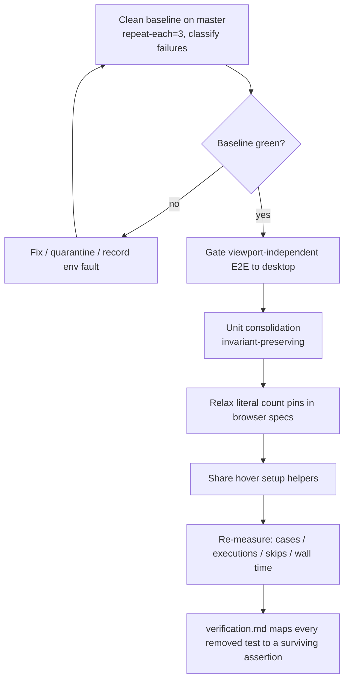
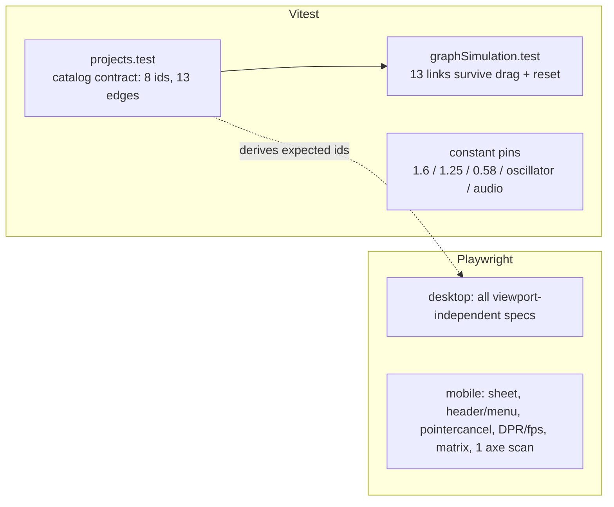

> [!NOTE]
> This document specifies **technical system architecture only** (data flow, storage, APIs, concurrency, state synchronization, and security).
> All visual, aesthetic, and UI design decisions (colors, typography, component styling, responsive layout) must be defined in `design.md`.

## Context

The repo runs two test layers: Vitest unit tests (206 tests, 19 files, well under 1 s of test time) and Playwright E2E (`playwright.config.ts`: `desktop` = Desktop Chrome, `mobile` = Pixel 7, `workers: 1`, local dev server on port 5199). CI runs `typecheck`, `build`, `test:unit` with `REQUIRE_DIST=1`, then `test:e2e`. A separate preview workflow runs `preview-headers.spec.ts` and a subset of `portfolio.spec.ts` against a live Vercel preview.

The last full run on `master` executed 108 project executions (41 of 72 spec titles run on both projects), skipped 36, and had 14 failures, 9 of which were `ERR_CONNECTION_REFUSED` dev-server drops. See `research.md` for the measured numbers and how each was verified.

This change touches **test code only**. No application source, build config, or CI workflow changes.

## System Architecture Diagram

## Goals / Non-Goals

**Goals:**
- Remove only redundancy: the same invariant asserted in several layers, or the same browser behavior executed on a project where it cannot differ.
- Preserve every guarded invariant. Every removed or merged test is mapped to a surviving assertion.
- Make browser completeness checks independent of the literal project count.
- Report cases, executions, and skips separately, and re-measure wall time after gating.

**Non-Goals:**
- A condition-based camera-settled signal replacing `waitForTimeout(1500/1600)`. That needs an app-side hook and is a separate follow-up change.
- Changing Playwright `workers`, projects, retries, or sharding.
- Making `buildOutput.test.ts` unconditional.
- Reshaping `e2e/preview-headers.spec.ts` or the preview workflow.
- Any lower test-count target.

## Technical Decisions

1. **Gate with `test.skip(isMobile(testInfo), reason)` inside each spec.**
   Alternatives: per-project `testIgnore` globs (needs splitting the 1733-line spec file, hides which specs are gated); `testMatch` tags. Chosen because the repo already uses 26 such skips, the reason string shows up in the reporter, and the diff is a few lines per spec.

2. **Gate on desktop, not mobile, for viewport-independent specs.** Desktop runs the full hover/drag/cursor set and is the project CI also exercises against the preview, so keeping desktop as the single home loses nothing and keeps one canonical run.

3. **Keep one mobile axe scan: the open project drawer.** The drawer becomes a bottom sheet on mobile, the only surface whose layout (and therefore contrast and target-size results) differs materially. Other axe surfaces are DOM-driven and match desktop. Axe is ~11% of E2E time, so merging axe/theme pairs is **not** part of this change.

4. **Derive browser completeness from the catalog.** The list and semantic-nav specs import `projects` (or the existing `PROJECT_IDS` constant, replaced by a catalog-derived list) and assert one card and one nav entry per id. Alternative of keeping `toHaveCount(8)` rejected: it breaks on a ninth project even though the contract is "everything in the catalog renders". The literal `8` stays asserted once, in `projects.test.ts`.

5. **Fold constant pins only into tests that still assert the literal.** A behavioral test that imports `SNAP_MULTIPLIER` to build its input does not guard the value. When folding, the surviving test keeps an explicit `expect(CONSTANT).toBe(1.6)` (or equivalent). Alternative of deleting the pins rejected: constant drift would go green.

6. **Two layers of edge assertions.** Catalog layer asserts the derived edge set (13) once; simulation layer asserts links survive drag + reset. Geometry and planarity tests drop their count pins but keep their geometric assertions.

7. **Helpers over merging.** Extend `hoverCenteredNode` / `focusNode` / `tapCenteredNode` for setup reuse. Merging scenarios (theme phases, About variants) rejected: a failure then fails the whole story and reports a vague title.

8. **Baseline gate.** The refactor is only judged against a clean baseline: failures are re-run with `--repeat-each=3`, and `ERR_CONNECTION_REFUSED` is treated as an environment fault. If a real regression is found on `master`, it is fixed or quarantined in a separate commit, not hidden by the refactor.

9. **Rebase and re-baseline when `master` moves (PR #16).** The branch was verified on the 8-project base. PR #16 added a 9th project, three E2E specs, and new unit tests, and conflicts in four test files. The branch is rebased and a new baseline recorded before more refactoring; pass-1 numbers stay in `verification.md` as history. Alternative of merging `master` into the branch rejected only on history grounds; either is acceptable if conflicts resolve the same way.

10. **Split the art-wip scenario by phase, with a shared helper.** The unlock spec walks locked state, unlock, drawer contents, reset, reload, and double reset in one test, so one failure hides nine phases. Three tests (locked / unlock plus inspector / reset) share `dragArtToCenter`. This applies decision 7 in the other direction: share setup, split assertions. Alternative of leaving it alone rejected because the failure title would not name the phase.

11. **Persistence is owned by the unit layer.** `artDiscovery.test.ts` covers the storage round-trip and malformed-JSON recovery. Exactly one E2E reload assertion remains as the wiring check. Alternative of deleting the E2E reload check rejected: it is the only test that the real page restores state.

12. **Wait on existing signals, defer the rest.** The canvas already exposes `data-art-node-pos` and `data-art-unlocked`, so the art specs' 800 ms and 350 ms sleeps become condition waits now. The 1500/1600 ms camera sleeps have no signal and stay deferred to the camera-settled change. Alternative of doing both here rejected because the camera signal needs an app-side hook.

13. **Hover-dwell spec derives its margin from the constant.** With `HOVER_DWELL_MS = 200` the spec's 100 ms check leaves 100 ms of slack. The intermediate wait should be tied to the constant and stay within half the dwell. Alternative of widening the dwell in the test rejected: it would stop testing the real value.

14. **`/art/` is a viewport-independent spec and a build artifact.** The E2E spec is gated to desktop. A conditional `dist/art/index.html` assertion in `buildOutput.test.ts` guards the build output, skipped without `dist/` and failing under `REQUIRE_DIST=1`, preserving the tolerant local `test:unit` behavior.

## Risks / Trade-offs

- **Rebase resolves a conflict the wrong way and drops a PR #16 assertion** → diff the post-rebase test files against `origin/master` and confirm every PR #16 test case still exists, apart from the intentional splits and consolidations.
- **Splitting the unlock spec triples page loads and slows the art specs** → the helper keeps setup to one drag each; wait on signals, not sleeps; accept a small cost for named failures.
- **Hiding a mobile gap by keeping a mobile spec** → record the touch-drag unlock gap explicitly in `verification.md`.
- **`art-wip` is hidden until unlocked, so derived nav/list counts could mismatch** → verify the derived completeness checks against the real DOM in task 6.3 before trusting them.

- **A gated spec stops catching a mobile-only regression** → gate only specs with layout- and input-independent assertions; keep the drawer axe scan and all sheet/header/menu/pointercancel/DPR/matrix specs on mobile; verify in `verification.md` that every spec still executes on at least one project.
- **Folding a constant pin silently drops its literal assertion** → require an explicit literal assertion in every surviving test; reviewer checks the mapping table in `verification.md`.
- **Flaky specs distort the before/after timings** → timings are taken from the clean baseline run, not the 14-failure run; report variance if a rerun differs.
- **Count pins removed from E2E but the catalog test drifts** → the catalog contract test stays the single place the literal `8` and `13` are asserted.
- **Gating saves less than expected** (~10 s from the 11 viewport-independent mobile runs) → accepted; the large win is the camera-settled signal in the follow-up change, and this change is justified by reduced noise and a clean baseline.

## Migration & Rollback Plan

Test-only change, shipped as one PR on a feature branch. Order: baseline triage, E2E gating, unit consolidation, count-pin relaxation, helper reuse, re-measurement. Each step is its own commit so any can be reverted independently. Rollback is `git revert` of the offending commit; there is no data or deployment migration.
