> [!NOTE]
> This document specifies **technical system architecture only** (data flow, storage, APIs, concurrency, state synchronization, and security).
> All visual, aesthetic, and UI design decisions (colors, typography, component styling, responsive layout) must be defined in `design.md`.

## Context

The portfolio is a client-side React 19.3 single-page application built on Vite, deployed to Vercel's global Edge CDN, and running an in-browser physics engine (d3-force) alongside SVG/HTML overlays. Evaluator audits identified that initial node seeding caused edge crossings in the $K_4$ subgraph, bridge geometry was asymmetrically lopsided, light theme contrast needed hardening, and candidate bio copy needed canonical alignment with verified Brown University background.

## System Architecture Diagram

```mermaid
flowchart TD
    subgraph DataLayer ["Data Layer (Single Sources of Truth)"]
        ProfileData["src/data/profile.ts\n(CandidateProfile: Brown University bio, email, social links)"]
        GraphSeeds["src/data/graphSeeds.ts\n(PLANAR_NODE_SEEDS: K4 nested planar layout)"]
        ProjectCatalog["src/data/projects.ts\n(ProjectData[]: mandatory shortTitle, repo, liveUrl)"]
    end

    subgraph Client ["Client Browser Runtime (React 19.3)"]
        ThemeInit["public/theme-init.js\n(Synchronous blocking script: reads localStorage)"]

        subgraph State ["Application State (App.tsx)"]
            ActiveProject["activeProjectId: string | null"]
            HoveredProject["hoveredProjectId: string | null"]
            ViewModeState["view: 'graph' | 'list'"]
            ThemeState["theme: 'light' | 'dark' (Default: 'light')"]
        end

        subgraph GeometryLayer ["Mathematical Geometry & Physics"]
            BridgeMath["src/utils/bridgeGeometry.ts\n(C1 tangent vectors, normal-mirrored control points)"]
            SimEngine["src/physics/graphSimulation.ts\n(d3-force: weak seed homing strength 0.02)"]
        end

        subgraph HUD ["Presentation Components"]
            Controls["ControlsOverlay\n(Header: About, GitHub, Graph, Theme, Filters)"]
            About["AboutModal\n(Brown University Bio, Top Contact Actions)"]
            Drawer["ProjectDrawer\n(Sticky Header: Code + Visit ↗, Segmented Tab Track)"]
            HoverCard["NodeHoverCard\n(Interactive with 150ms Transfer Zone)"]
            Grid["ListView\n(16:9 Thumbnails + Terminal Specimen Fallback)"]
        end
    end

    subgraph Edge ["Vercel Edge CDN Infrastructure"]
        VercelJson["vercel.json\n(CSP: frame-src 'self' https://drive.google.com)"]
        CspGuard["src/utils/csp.ts\n(SPEC_CSP synchronized)"]
    end

    ThemeInit -.-> ThemeState
    ProfileData --> About
    ProfileData --> Controls
    GraphSeeds --> SimEngine
    ProjectCatalog --> SimEngine
    ProjectCatalog --> Grid
    BridgeMath --> SimEngine
    VercelJson -.-> Client
    CspGuard -.-> VercelJson
```

## Goals / Non-Goals

**Goals:**
- Provide a provably planar resting layout for the 6 projects by nesting `sandwave-sim` inside the $K_4$ triangle, backed by weak d3-force seed-homing (`strength: 0.02`).
- Enforce 100% bilateral reflection symmetry across all fluid bridges using tangent-continuous Bézier geometry (`computeBridgeGeometry`), complete with close-node guards.
- Default new visitors to Light theme while preventing dark-user first-paint flash via `public/theme-init.js`.
- Standardize typography across the codebase on Helvetica / Helvetica Neue, Helvetica Light (`font-weight: 300`), and Menlo for monospace.
- Surface canonical candidate credentials (Brown University bio, email, social links) cleanly at the top of the About modal.

**Non-Goals:**
- Replacing d3-force with alternative physics engines.
- Client-side PDF rendering via heavy WebAssembly bundles (click-to-load iframe handles previews).
- Backend server-side rendering or database APIs (100% static edge SPA).

## Technical Decisions

### 1. Planar Graph Seed Geometry & Weak Homing
- **Topology Analysis**: The 6 projects contain a complete $K_4$ subgraph (`open-dungeon`, `transcribe-plus`, `sandwave-sim`, `attention-max`).
- **Mathematical Solution**: Fáry's theorem guarantees a straight-line planar drawing if and only if one vertex is embedded strictly inside the interior triangle of the other three. Placing `sandwave-sim` at `(0.56, 0.55)` inside $\triangle(\text{OD}, \text{TP}, \text{AM})$ yields exactly 0 segment intersections.
- **Physics Stabilization**: Pure spring forces can distort planarity. We add weak `seedX` and `seedY` forces (`strength: 0.02`) toward the scaled seed coordinates. Nodes remain fully draggable and flingable, but gently breathe back to their planar resting positions.

### 2. Bilateral Tangent-Continuous Bridge Geometry
- **Formulation**: In `src/utils/bridgeGeometry.ts`:
  1. Unit direction vector $\vec{u} = \frac{B - A}{\|B - A\|}$, normal $\vec{n} = (-u_y, u_x)$.
  2. Anchor spread angle $\theta = \min\left(\frac{\pi}{6.5}, \arcsin\left(\frac{h}{R}\right)\right)$.
  3. Anchor points $A_{top} = A + R_A(\cos\theta \vec{u} + \sin\theta \vec{n})$ and $A_{bottom} = A + R_A(\cos\theta \vec{u} - \sin\theta \vec{n})$.
  4. Forward tangent pointing toward waist: $\vec{T}_{A,top} = \sin\theta \vec{u} - \cos\theta \vec{n}$.
  5. Reflected tangent for bottom: $\vec{T}_{A,bottom} = \sin\theta \vec{u} + \cos\theta \vec{n}$.
  6. Bottom curve control points are exact normal reflections of top curve control points across $\vec{u}$.
  7. Close-node guard: when distance $d \le R_A + R_B$, returns `null` to avoid inverted curve geometry.

### 3. First-Paint Flash Prevention & Default Light Theme
- **Implementation**: Synchronous script `public/theme-init.js` included in `<head>` before stylesheets. It inspects `localStorage.getItem('portfolio_theme')` and immediately assigns `data-theme` on `<html>`. If unset, `<html>` falls back to default light theme.
- **CSP Compliance**: Served from `'self'` via ``, fully compliant with `script-src 'self'`.

### 4. Segmented Tab Track & Elevated Actions
- **Drawer Tabs**: The redundant `Link` tab is eliminated in favor of elevated `Code ↗` and `Visit ↗` buttons in the sticky header.
- **Segmented Control**: The remaining preview modalities (`Media`, `Terminal`) sit in a rounded segmented container (`bg-[var(--color-surface-container)] rounded-full p-1`) clearly separated from project tags.

## Risks / Trade-offs

- **[Risk] High-Degree Hub Merging**: `open-dungeon` connects to 5 neighbors. Large bridge anchors could overlap on its perimeter.
  &rarr; *Mitigation*: Cap spread angle $\theta \le 28^\circ$ ($\pi / 6.5$) to guarantee clearance between adjacent bridges.
- **[Risk] Touch Target Size on Segmented Tabs**: Compact segmented tabs can fail mobile accessibility if $< 44\text{px}$.
  &rarr; *Mitigation*: Set `min-h-[44px]` touch targets on mobile viewports.

## Migration & Rollback Plan

- **Zero DB Migrations**: 100% static client code and styling.
- **Rollback Strategy**: Git revert cleanly restores previous assets without residual state.
