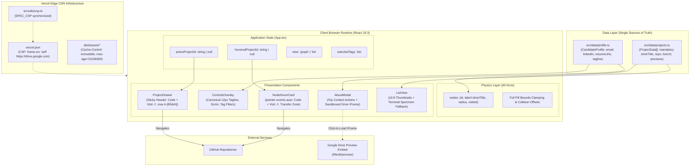

> [!NOTE]
> This document specifies **technical system architecture only** (data flow, storage, APIs, concurrency, state synchronization, and security).
> All visual, aesthetic, and UI design decisions (colors, typography, component styling, responsive layout) must be defined in `design.md`.

## Context

The portfolio is a client-side React 19.3 single-page application built on Vite, deployed to Vercel's global Edge CDN, and running an in-browser physics engine (d3-force) alongside SVG/HTML overlays. Current evaluations highlighted that candidate conversion was impeded by missing recruiter data channels, buried external links, and rigid iframe security headers that prevented embedding Google Drive document previews.

## System Architecture Diagram

## Goals / Non-Goals

**Goals:**
- Decouple candidate profile identity from project records by introducing `src/data/profile.ts`.
- Provide zero-bundle-overhead embedded document inspection for the candidate's Google Drive resume by adapting Vercel Edge CSP to permit `frame-src https://drive.google.com;`, synchronizing `SPEC_CSP` in `src/utils/csp.ts`.
- Enforce mandatory `shortTitle: string` compile-time type safety across all 6 project entries.
- Implement robust pointer transfer grace periods between canvas nodes and `NodeHoverCard` (cancel-on-enter, re-arm on leave, dismiss-on-drag).
- Guard mobile ergonomics using dynamic viewport units (`max-h-[85dvh]`).

**Non-Goals:**
- Client-side PDF rendering via heavy WebAssembly or PDF.js bundles.
- Backend server-side rendering or database APIs (the architecture remains a 100% static edge SPA).
- Replacing d3-force with alternative canvas physics libraries.

## Technical Decisions

### 1. Dedicated `CandidateProfile` Data Layer
- **Choice**: Create `src/data/profile.ts` exporting a strongly typed `CandidateProfile` object.
- **Contract**: Contains `name`, `canonicalTitle`, `tagline`, `email`, `linkedIn`, `github`, `resumeUrl`, and `resumeEmbedUrl`.
- **Rationale**: Isolates candidate contact channels and canonical branding from repository project models (`ProjectData`), facilitating clean unit testing of URL protocols (`mailto:`, `https:`).

### 2. Click-to-Load Sandboxed Google Drive Preview
- **Choice**: Embed `https://drive.google.com/file/d/1zcDDcEDFt9oXSsbcvQObDyr1py2OjimW/preview` inside a sandboxed `<iframe>` only after user interaction ("Preview Resume" click).
- **Security & Privacy Attributes**:
  - `title="Resume - Gregory Lazatin"`
  - `referrerpolicy="no-referrer"`
  - `sandbox="allow-scripts allow-same-origin allow-popups"`
  - `loading="lazy"`
- **CSP Coordination**: Add `frame-src 'self' https://drive.google.com;` to `vercel.json` and update `SPEC_CSP` in `src/utils/csp.ts` so guard tests and the preview deployment gate pass cleanly.

### 3. Simulation Input Type Extension & Mandatory `shortTitle`
- **Choice**: Extend `SimulationNode` in `src/physics/graphSimulation.ts` to `{ id: string; label?: string }`.
- **Data Flow**: `projects.ts` defines required `shortTitle: string`. `GraphCanvas.tsx` maps projects to `simNodes` passing `label: p.shortTitle`. `createSimulation` maps `label: n.label || n.id`.

### 4. Hover Card Transfer Zone State Machine
- **State Flow**:
  1. Hovering node `H`: mounts `NodeHoverCard` at computed clamp coordinates.
  2. Pointer leaves node `H`: begins a 150ms timeout.
  3. Pointer enters `NodeHoverCard`: `onMouseEnter` on card invokes `clearTimeout`, cancelling dismissal.
  4. Pointer leaves `NodeHoverCard`: `onMouseLeave` restarts the 150ms timeout.
  5. Pointer begins drag on canvas: canvas `dragstart` immediately unmounts card and cancels any pending timers.

### 5. Multi-Node Label Collision Avoidance
- **Choice**: When two nodes settle with center-to-center Euclidean distance $< 70\text{px}$, the rendering loop alternates vertical placement (`y - radius - 8` vs `y + radius + 18`) to ensure both labels remain fully legible.

## Risks / Trade-offs

- **[Risk] Google Drive Preview Permission Requirement**: If owner does not configure "Anyone with link can view", Drive renders a sign-in prompt.
  &rarr; *Mitigation*: Direct `Resume (Drive) ↗` button remains the primary high-visibility action above the embed.
- **[Risk] Hover Card Event Slip**: Moving mouse across canvas might trigger rapid hover card flicker.
  &rarr; *Mitigation*: 150ms transfer timeout + drag cancellation keeps interaction stable.
- **[Risk] Mobile Viewport Clamping**: Long labels might push nodes against screen boundaries.
  &rarr; *Mitigation*: Full rectangular bounds clamping `[pillX, pillY, pillWidth, pillHeight]` keeps labels inside canvas padding.

## Migration & Rollback Plan

- **Zero DB Migrations**: Entire change is static code, TypeScript types, and configuration.
- **Rollback Strategy**: Git revert of commit cleanly restores previous CSP headers and layout without residual server state.
