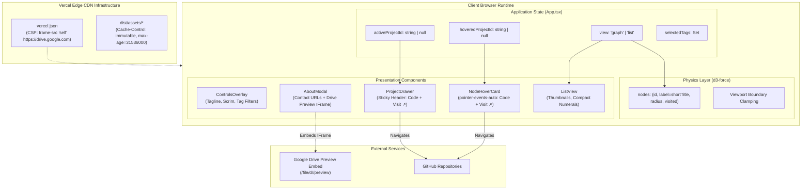

> [!NOTE]
> This document specifies **technical system architecture only** (data flow, storage, APIs, concurrency, state synchronization, and security).
> All visual, aesthetic, and UI design decisions (colors, typography, component styling, responsive layout) must be defined in `design.md`.

## Context

The portfolio is a client-side React 18 single-page application built on Vite, deployed to Vercel's global Edge CDN, and running an in-browser physics engine (d3-force) alongside SVG/HTML overlays. Current evaluations highlighted that candidate conversion was impeded by missing recruiter data channels, buried external links, and rigid iframe security headers that prevented embedding Google Drive document previews.

## System Architecture Diagram

## Goals / Non-Goals

**Goals:**
- Provide zero-bundle-overhead embedded document inspection for the candidate's Google Drive resume by adapting Vercel Edge CSP to permit `frame-src https://drive.google.com`.
- Maintain compile-time type safety across all project models via TypeScript `ProjectData` extensions (`shortTitle`).
- Decouple canvas simulation display strings from internal project identifiers to prevent physics collision artifacts.
- Enable direct pointer interaction on `NodeHoverCard` while preserving smooth canvas raycasting and drag mechanics.

**Non-Goals:**
- Client-side PDF rendering via heavy WebAssembly or PDF.js bundles.
- Backend server-side rendering or database APIs (the architecture remains a 100% static edge SPA).
- Replacing d3-force with alternative canvas physics libraries.

## Technical Decisions

### 1. Embedded Document Rendering via Google Drive Preview
- **Choice**: Embed `https://drive.google.com/file/d/1zcDDcEDFt9oXSsbcvQObDyr1py2OjimW/preview` inside a sandboxed `<iframe>` within `AboutModal.tsx`.
- **Alternatives Considered**:
  - `pdfjs-dist` / `react-pdf`: Adds ~450KB to JS bundle, requires Web Worker setup and polyfills for canvas text layers.
  - Direct PDF link only: Forces recruiters to leave the application tab, lowering session retention.
- **Security Requirement**: Amend `vercel.json` CSP from `default-src 'self'` to explicitly include `frame-src 'self' https://drive.google.com;`.

### 2. Dual-Title Architecture (`id`, `title`, and `shortTitle`)
- **Choice**: Extend `ProjectData` in `src/types/portfolio.ts` with optional `shortTitle?: string`.
- **Mapping**:
  - `open-dungeon` &rarr; `OpenDungeon`
  - `agentic-resume-builder` &rarr; `Resume Builder`
  - `pict-climate-risk-viz-chatbot` &rarr; `Climate Risk`
  - `transcribe-plus` &rarr; `Transcribe+`
  - `sandwave-sim` &rarr; `Sandwave`
  - `attention-max` &rarr; `AttentionMax`
- **Data Flow**: `GraphCanvas.tsx` maps catalog projects to simulation nodes assigning `label = p.shortTitle || p.title`. `graphSimulation.ts` assigns `label: n.label` instead of defaulting to `n.id`. Full titles remain in `NodeHoverCard`, `ProjectDrawer`, and `ListView`.

### 3. Hover Card Hit-Testing & Retention Zone
- **Choice**: Switch `NodeHoverCard` from `pointer-events-none` to `pointer-events-auto`. Wrap child links in `onClick={(e) => e.stopPropagation()}` to allow opening `Code ↗` or `Visit ↗` directly in a new tab without triggering the parent card click (`onSelect(project.id)`).
- **Grace Retention**: Provide a 150ms debounce timeout on node pointer departure or cursor proximity detection so the card remains active as the cursor glides from the node into the card bounds.

### 4. Edge Asset Delivery for Media
- **Choice**: Direct Vite asset imports (`dist/assets/`). Vercel's Edge CDN caches all `/assets/*` files with immutable 1-year headers (`Cache-Control: public, max-age=31536000, immutable`).

## Risks / Trade-offs

- **[Risk] Google Drive Preview CSP / Cookie Block**: Third-party cookies or enterprise network policies may occasionally restrict Google Drive preview iframes.
  &rarr; *Mitigation*: Always provide a prominent fallback button (`Resume ↗`) linking directly to the full Google Drive file view URL with `target="_blank"`.
- **[Risk] Hover Card Event Slip**: Moving mouse across canvas might trigger rapid hover card flicker.
  &rarr; *Mitigation*: Debounce dismissals by 150ms and ignore hover card updates during active canvas drag or coasting states.
- **[Risk] Mobile Viewport Clamping**: Long labels might push nodes against screen boundaries.
  &rarr; *Mitigation*: Implement clamped pill rendering in `GraphCanvas.tsx` with a 12px bounding margin.

## Migration & Rollback Plan

- **Zero DB Migrations**: Entire change is static code, TypeScript types, and configuration.
- **Rollback Strategy**: Git revert of commit cleanly restores previous CSP headers and layout without residual server state.
