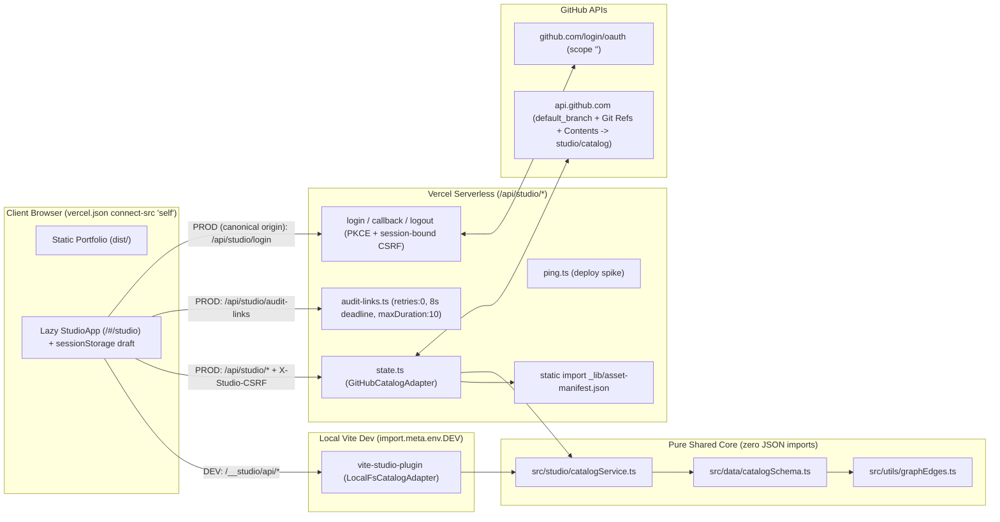

> [!NOTE]
> This document specifies **technical system architecture only** (data flow, storage, APIs, concurrency, state synchronization, and security).
> All visual, aesthetic, and UI design decisions (colors, typography, component styling, responsive layout) must be defined in `design.md`.

## Context
- `src/data/projects.ts` hydrates `src/data/projects.catalog.json` synchronously at build time via Vite's `import.meta.glob`, and `vercel.json` enforces `connect-src 'self'`, `img-src 'self'`, and `media-src 'self'`.
- `.vercelignore` (`L10`) excludes `scripts/`, and `catalogSchema.ts` currently imports `graphTopology.ts` → `tagRegistry.ts` → `projects.catalog.json`.
- To provide remote Studio access without a runtime database or relaxing CSP, the deployment becomes a **static portfolio with authenticated serverless Studio APIs (`/api/studio/*`)** plus a lazy-loaded `StudioApp` chunk at `/#/studio`.

## System Architecture Diagram

## Goals / Non-Goals

**Goals:**
- Static portfolio with authenticated serverless Studio APIs: zero secrets/server code in client bundles, main portfolio chunk free of `studio-app` UI, and `503`/`401` gating on `/api/studio/*`.
- Pure server-side schema core (`graphEdges.ts` → `catalogSchema.ts` → `catalogService.ts`) with zero JSON imports, verified first via an `api/studio/ping.ts` Vercel deploy spike.
- Committed `api/studio/_lib/asset-manifest.json` guarded by a unit drift test.
- Canonical-domain GitHub OAuth (`scope: ""`, PKCE + one-time `state` always cleared), 2h `studio_session` TTL (revocable via `STUDIO_SESSION_SECRET` rotation), and session-bound `studio_csrf` (`HMAC(secret, sid)`).
- Full `studio/catalog` branch lifecycle relative to `default_branch`, bounded `audit-links` (`retries: 0`, shared `8000ms` deadline, `maxDuration = 10`), and `sessionStorage` draft persistence across OAuth redirects.

**Non-Goals:**
- OAuth sign-in from arbitrary `https://<vercel-preview>/#/studio` URLs (previews are for visual review of `studio/catalog` after Save).
- Image/video binary uploads from `/#/studio` (deferred to v2).
- Separate Vercel project hosting for Studio.

## Technical Decisions
1. **Pure `src/utils/graphEdges.ts` + Vercel Deploy Spike (`api/studio/ping.ts`)**
   - *Choice*: Extract `deriveEdgesPure(projects, hiddenTags)` with zero `tagRegistry.ts`/`projects.catalog.json` imports; add `api/` to `tsconfig.json`; deploy `ping.ts` first. *Why*: Prevents dragging JSON imports into every serverless function and validates ESM/Vercel bundling before building all 5 handlers.
2. **Committed `api/studio/_lib/asset-manifest.json` + Drift Test vs. `scripts/` Build Step**
   - *Choice*: Commit the manifest under `_lib/` and assert parity with `src/assets` + `src/data/captured` in `npm run test:unit`. *Why*: `.vercelignore` excludes `scripts/` (`L10`), and gitignored generated files break fresh-clone `typecheck`.
3. **Canonical-Domain OAuth, Empty Scope, 2h Session-Bound CSRF & Kill Switch**
   - *Choice*: Empty OAuth scope (`""`), discard GitHub user access token immediately after `GET /user` (`STUDIO_OWNER_ID`), 2h `studio_session` TTL, `studio_csrf = HMAC(STUDIO_SESSION_SECRET, sid)`, exact `STUDIO_OAUTH_REDIRECT_URI` (canonical domain only). *Why*: Minimizes OAuth blast radius; rotating `STUDIO_SESSION_SECRET` immediately invalidates all sessions.
4. **Dynamic `default_branch` & `studio/catalog` Lifecycle**
   - *Choice*: Query repo `default_branch`; `GET` reads `studio/catalog` only if it exists and is ahead of `default_branch`, otherwise `default_branch`. `PUT` creates or resets `refs/heads/studio/catalog` to `default_branch` HEAD via Git Refs API (treating concurrent `422 Reference already exists` as success) before Contents `PUT`, mapping `409` and `sha`-mismatch `422` to `409 Conflict`.
5. **PAT Blast Radius & `master` Branch Protection**
   - *Choice*: Scope `GITHUB_PAT` (`contents: write`) to `slowbutfast/portfolio` only, set an expiry/rotation cadence, and enforce GitHub branch protection / ruleset on `master` requiring PRs (including administrators).

## Risks / Trade-offs
- `[Long-lived GITHUB_PAT could push to master]` → Enforce `master` branch protection/ruleset requiring PRs (including administrators) + repo-scoped PAT with expiry.
- `[Leaked studio_session cookie before expiry]` → 2h TTL + instant revocation by rotating `STUDIO_SESSION_SECRET` on Vercel.
- `[In-memory rate limit resets on cold starts]` → Best-effort per warm instance; primary protection is owner-only auth + `X-Studio-CSRF` + `retries: 0` + `8000ms` shared deadline + `maxDuration = 10`.

## Migration & Rollback Plan
- **Deploy**: Complete owner ops (OAuth App on canonical callback, repo-scoped PAT, `master` branch protection, Vercel env vars), deploy, sign in on canonical `/#/studio`, and save to `studio/catalog`.
- **Rollback**: Unset Vercel Studio env vars (deterministic `503` on `/api/studio/*`) or revert the PR.
