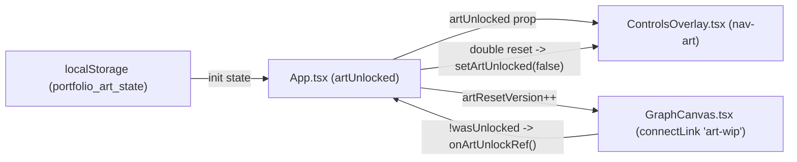

> [!NOTE]
> This document specifies **technical system architecture only** (data flow, storage, APIs, concurrency, state synchronization, and security).
> All visual, aesthetic, and UI design decisions (colors, typography, component styling, responsive layout) must be defined in `design.md`.

## Context

`art-wip` discovery state (`unlocked`, `connectedIds`, `maxConnections`) is persisted in `localStorage` under `portfolio_art_state` (`src/utils/artDiscovery.ts`) and mutated inside `GraphCanvas.tsx`'s `requestAnimationFrame` render loop (`L648-L661`). `ControlsOverlay.tsx` is a sibling of `GraphCanvas.tsx` rendered by `App.tsx`, and `App.tsx` already owns `resetAll()` and `artResetVersion`.

## System Architecture Diagram

## Goals / Non-Goals

**Goals:**
- Keep `App.tsx` as the single React state owner coordinating `GraphCanvas` (unlock source + reset target) and `ControlsOverlay` (nav link presentation).
- Avoid restarting `GraphCanvas` simulation `useEffect`s when `onArtUnlock` fires by storing the callback in `onArtUnlockRef`.

**Non-Goals:**
- Polling `localStorage` or adding a `storage` event listener.
- Changing `artDiscovery.ts` storage schema or `art-wip` proximity/latching rules.

## Technical Decisions

1. **Lift `artUnlocked` state to `App.tsx` instead of reading `localStorage` in `ControlsOverlay`**:
   - *Rationale*: `GraphCanvas` unlocks `art-wip` in-memory during a `requestAnimationFrame` pass, and `App.tsx` resets it synchronously in `resetAll()`. Passing `artUnlocked` down and `onArtUnlock` up ensures instant React re-rendering without polling `localStorage`.
   - *Alternative considered*: Custom DOM `CustomEvent` on `window`. Rejected as unnecessary indirection when `App.tsx` is already the direct parent of both components.
2. **Wrap `onArtUnlock` in `onArtUnlockRef` inside `GraphCanvas.tsx`**:
   - *Rationale*: Matches `onCanvasInteractRef`, `onClearFocalRef`, and `onCanvasDragStartRef` in `GraphCanvas.tsx` so the simulation setup effect never depends on callback identity.

## Risks / Trade-offs

- **Multiple calls to `onArtUnlock` during subsequent connections**: Guarded with `if (!wasUnlocked)` at `GraphCanvas.tsx:653-661` so `setArtUnlocked(true)` is only invoked once on the `false -> true` transition.

## Migration & Rollback Plan

- Purely additive client-side prop and conditional link; rollback is a single-commit revert of the three component files and E2E test.
