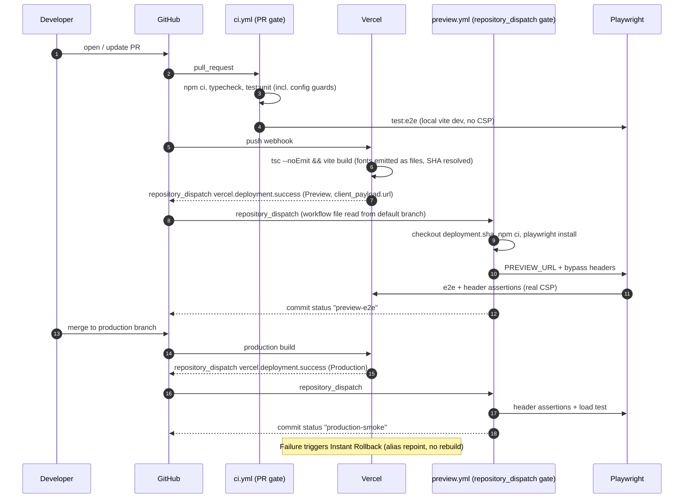

> [!NOTE]
> This document specifies **technical system architecture only** (data flow, storage, APIs, concurrency, state synchronization, and security).
> All visual, aesthetic, and UI design decisions (colors, typography, component styling, responsive layout) must be defined in `design.md`.

## Context

The portfolio is a static Vite SPA deployed through Vercel's GitHub integration (repo `slowbutfast/portfolio`; project link and production branch are unverified, see research.md). `vercel.json` carries the CSP, security headers, and the cache rule. Verified state on `master` (`de357c0`):

- `vercel.json` already matches the `edge-deployment` spec: strict CSP, one `/assets/(.*)` immutable rule. `vite.config.ts` already sets `assetsInlineLimit: 0`. Nothing tests either.
- No CI exists. `npm run build` is `vite build`, so type errors do not fail a deploy.
- `playwright.config.ts` can target `PREVIEW_URL`, but sends no authentication. `trackErrors()` is asserted in two tests only.
- Local e2e runs against `vite dev`, which applies no `vercel.json` headers, so the CSP is exercised only on a deployed build.
- `__COMMIT_HASH__` is resolved inline in `vite.config.ts` (git first, Vercel variable only if git throws), untested, and git stderr leaks into build logs.
- `.vercelignore` excludes `.git/`, `openspec/`, `e2e/`, `scripts/`, `dist/`. Anything `vite.config.ts` imports at build time must live outside those paths.

## System Architecture Diagram

## Goals / Non-Goals

**Goals:**
- Every PR is typechecked, unit-tested, and e2e-tested before merge.
- Every preview and production deployment is tested at its real URL under its real headers, automatically.
- The committed `vercel.json` cannot drift from the spec (unit guards) and the served headers cannot drift from the spec (preview assertion).
- The build never fails because of build-metadata resolution and never silently ships inlined fonts.
- The Deployment Protection bypass secret never reaches logs or downloadable artifacts.

**Non-Goals:**
- Changing the CSP. The committed policy already matches the spec; the preview gate reveals whether the app works under it.
- Lighthouse CI thresholds, analytics, Speed Insights.
- Custom domains, DNS, or environments beyond Preview and Production.
- Replacing the Vercel GitHub integration with CLI deploys.
- Any visual/UI change (see `design.md`).

## Technical Decisions

### 1. Pin existing config with tests, don't rewrite it
- **Decision**: Add Vitest guards that parse `vercel.json`: exactly one header rule for `/assets/(.*)` with the immutable value, and the CSP parsed into a directive map equal to the spec's map. Add a build-output guard that greps `dist/` for `data:font` and asserts at least one `.woff2`. Leave `vercel.json` and `assetsInlineLimit: 0` unchanged.
- **Rationale**: Both are already correct; the risk is silent regression (this repo has already seen an uncommitted looser copy of `vercel.json`). Tests make the spec executable.
- **Alternatives**: A `.woff2` cache rule or a `.woff2`-only inline callback (rejected: redundant); a JSON-schema check of `vercel.json` (rejected: validates shape, not policy).

### 2. `__COMMIT_HASH__` as a pure, injectable resolver
- **Decision**: `src/utils/commitHash.ts` exports `resolveCommitHash(env, runGit)` returning, in order, the first 7 chars of a non-empty `env.VERCEL_GIT_COMMIT_SHA`, the trimmed `runGit()` output, then `'dev'`. `runGit` is injected; `vite.config.ts` passes a try/catch around `execSync('git rev-parse --short HEAD', { stdio: ['ignore','pipe','ignore'] })`.
- **Rationale**: On Vercel the system variable is authoritative (shallow or missing clones cannot mislead it); locally git works; CLI uploads have no `.git`. Pure function makes all branches unit-testable under the existing Vitest config (`src/**/*.test.ts`).
- **Placement**: under `src/utils/` because `.vercelignore` excludes `scripts/`. `src/` is typechecked and never bundled into the client unless imported by app code.
- **Alternatives**: keep inline (rejected: untestable); a Vite plugin (rejected: more surface for one constant).

### 3. Typecheck inside the build script
- **Decision**: `"build": "tsc --noEmit && vite build"`.
- **Rationale**: `vercel.json` runs `npm run build`, so this makes typecheck a deployment gate with no extra Vercel configuration. Dev dependencies are installed for Vercel builds.
- **Alternatives**: typecheck only in CI (rejected as the sole guard: a push that bypasses PRs would deploy type errors).

### 4. Protection bypass in the Playwright layer
- **Decision**: In `playwright.config.ts`, when `VERCEL_AUTOMATION_BYPASS_SECRET` is set, `use.extraHTTPHeaders` includes `x-vercel-protection-bypass: <secret>` and `x-vercel-set-bypass-cookie: true`, and `trace` is forced to `off`. A `globalSetup` runs only when `PREVIEW_URL` is set and issues one request to the base URL; a 401 or a response identifying the Vercel authentication page aborts the run naming the missing or invalid secret.
- **Rationale**: Header injection leaves the app and tests unchanged. The pre-flight turns "every test failed with a login page" into one actionable error.
- **Why tracing is forced off**: traces record request headers, so an uploaded trace would expose the secret to anyone who can read artifacts.
- **Alternatives**: disabling Deployment Protection on previews (rejected: exposes unreleased work); per-run shareable links (rejected: need API calls and secrets anyway).

### 5. Workflows and the default-branch constraint
- **Decision**: `ci.yml` on `pull_request`; `preview.yml` on `repository_dispatch` type `vercel.deployment.success`. `preview.yml` records the dispatch payload to the run summary, resolves the URL (`client_payload.url`), SHA (`client_payload.git.sha`), and kind (`client_payload.environment`, falling back to the ref) in one step, checks out that SHA, passes `PREVIEW_URL`, and reports through the commit status API (`gh api repos/{repo}/statuses/{sha}` with `statuses: write`). It fails with a pointer to the recorded payload if the URL or SHA is missing.
- **Why not `deployment_status`**: verified that Vercel creates no GitHub Deployments for this project (`gh api repos/.../deployments` is empty after four Vercel deployments), so `deployment_status` never fires. Vercel's docs recommend `repository_dispatch` and state the workflow file must exist on the default branch.
- **Constraint**: the workflow file is read from the **default branch** (`master`), so the gate does nothing until `preview.yml` is merged there.
- **Rationale for commit status**: a `repository_dispatch` run is not attached to a PR, so a required check cannot depend on it directly; a commit status with a stable context can be marked required.
- **Permissions**: `contents: read`, `statuses: write`. Only first-party `actions/*` pinned by major version. No third-party "wait for Vercel" action.
- **Concurrency**: group per deployment SHA with cancel-in-progress.
- **Alternatives**: polling the Vercel API from the PR workflow (rejected: needs a broader-scope token); third-party wait-for-preview actions (rejected: supply-chain surface for something GitHub already emits).

### 5b. Local CSP emulation as a pre-flight
- **Decision**: Before relying on the deployment gate, a helper serves `dist/` with the headers parsed from `vercel.json` and runs the error-tracking tests against it.
- **Rationale**: `vite dev` and `vite preview` apply no custom headers, so the strict CSP has never been exercised against the redesigned app. Emulation catches obvious breakage (blocked inline styles, fonts, media) before a deploy.
- **Limit**: it is an approximation; Vercel's edge may add or normalise headers. The preview run remains authoritative.

### 6. Header assertion as data, not prose
- **Decision**: `e2e/preview-headers.spec.ts` (skipped unless `PREVIEW_URL` is set) holds the expected CSP as a directive map, parses the served header into the same shape, and compares as sets. It discovers `.woff2` URLs from `page.on('response')` during a real load and requests a non-existent `/assets/*.woff2` for the 404 check.
- **Rationale**: hashed filenames change every build, and exact-string comparison is brittle against directive order.

### 7. Broader error tracking, and honest skips
- **Decision**: reuse `trackErrors()` in the drawer-open, deep-link, About, and terminal tests. Skip the Profiler-based zero-commit test when `PREVIEW_URL` is set.
- **Rationale**: React production builds do not fire Profiler `onRender`, so that test passes vacuously against a preview. No separate CSP test is needed because Chromium reports CSP violations as console errors (to be confirmed on first preview run).

## Risks / Trade-offs

- **[Preview gate never fires]** wrong trigger or workflow not on the default branch → `repository_dispatch` plus the file on `master`; verify on the first deployment after merge.
- **[Required-check wiring]** A required status context only exists after it has reported once → run once, then add it to branch protection.
- **[Bypass secret leakage]** Traces, reports, or shell tracing could expose it → tracing off, secret only as an env var, no `set -x`, and a task scans artifacts.
- **[Strict CSP breaks the app on a real deploy]** Never exercised against the redesign → local emulation first, then the preview run; if it fails, the fix is a separate change.
- **[Edge propagation flakiness]** A fresh alias may briefly serve stale headers → test the deployment URL, not an alias, with `retries: 1` in CI.
- **[Hobby-plan Instant Rollback limits]** May only allow rolling back to the previous deployment → documented in README after checking the plan.
- **[MCP access]** Project state reads via the Vercel MCP need team access approval → tasks that depend on it are marked blocked, not skipped.

## Migration & Rollback Plan

1. **Config first (safe anywhere)**: resolver, build script, Playwright bypass and pre-flight, guard tests. Behaviour-compatible with today's app.
2. **Bootstrap the deployment gate**: open a PR adding `.github/workflows/ci.yml` and `preview.yml` to `jammy-falcon`; add the `VERCEL_AUTOMATION_BYPASS_SECRET` repository secret; confirm production branch and system-env exposure in Vercel Project Settings.
3. **Prove the gate**: merge the `repository_dispatch` workflow, let the resulting production deployment dispatch an event, confirm the run starts and a commit status appears; then do the same for a preview.
4. **Mark checks required**: after each context has reported once, add `ci` and `preview-e2e` to branch protection.
5. **Rollback of this change**: each piece is independently revertible with `git revert`; removing the workflows returns to today's manual flow. No data migration. If a deploy misbehaves, use Instant Rollback to the previous deployment.

## Open Questions

- What is the Vercel project's configured production branch: `jammy-falcon` or `master`?
- Is Deployment Protection enabled on previews, and is "Automatically expose System Environment Variables" on?
- What is the real `client_payload` shape (environment values, `git.sha`, `git.ref`, whether `url` includes a scheme)? The first run records it in the run summary.
- Can the commit status be required on a PR whose head SHA equals the deployed SHA, with no extra wiring?
- What does the Vercel plan allow for Instant Rollback targets?
- Why was an earlier uncommitted `vercel.json` looser than the committed one, and does the strict policy actually work?
